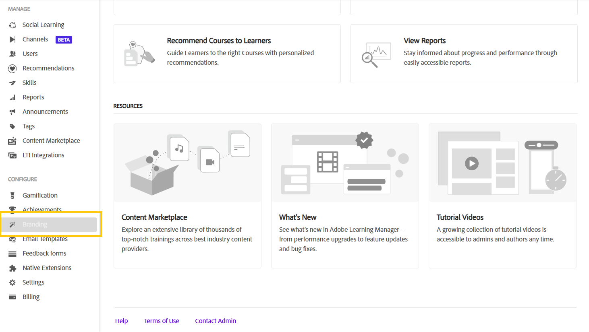

# Identité visuelle de l’administrateur : repositionnement des bandes de pages d’accueil PLP et VC

## Ajout et réorganisation de bandes de pages d’accueil dans Adobe Learning Manager

Ajoutez des bandes Personnalisé le parcours d’apprentissage et Virtual Coach à la page d’accueil de l’élève, et faites glisser et déposez les bandes pour définir l’ordre dans lequel les élèves voient.

En tant qu’administrateur, vous pouvez ajouter des bandes de parcours d’apprentissage personnalisé (PLP) et de coach virtuel à la page d’accueil de l’élève dans Adobe Learning Manager. Vous pouvez également réorganiser chaque bande de page d&#39;accueil avec des commandes de glisser-déposer dans **Identité visuelle de l&#39;administrateur**. Vous pouvez désormais décider quelles bandes les élèves voient en premier.

Vous pouvez également ajouter un widget Parcours d’apprentissage personnalisé à une page personnalisée.

### À propos des bandes de la page d’accueil

Les bandes de la page d’accueil sont les widgets (cartes) qui apparaissent sur la page d’accueil de l’élève. Dans le branding d’administrateur, vous pouvez choisir les bandes à afficher et leur ordre d’apparition. Dans la version de décembre 2026 d’ALM, deux bandes alimentées par l’IA sont disponibles :

* **Bande de parcours d’apprentissage personnalisé :** met en évidence les parcours d’apprentissage générés par l’IA pour chaque élève.
* **Virtual Coach strip :** aide les élèves à trouver et à ouvrir des expériences de coaching à partir de la page d’accueil.

### Bande du parcours d’apprentissage personnalisé

Les élèves peuvent utiliser la bande pour :

* Accédez aux parcours d’apprentissage générés par l’IA.
* Continuer les parcours d’apprentissage précédemment générés.
* Découvrez les parcours d’apprentissage recommandés.

### Virtual Coach strip

Les élèves peuvent utiliser la bande pour :

* Découvrez les expériences de Virtual Coach.
* Reprendre les activités de coaching.
* Démarrez le coaching conversationnel d’IA à partir de la page d’accueil.

### Réorganiser les bandes de la page d’accueil

Vous pouvez placer n’importe quelle bande dans n’importe quelle position. Par exemple, vous pouvez d&#39;abord afficher la bande de l&#39;entraîneur virtuel, puis les bandes des parcours d&#39;apprentissage personnalisés, **Recommandé** et **Catalogue**, puis **Récemment consultés**.

1. Dans l&#39;application administrateur, sélectionnez **Configurer** > **Identité visuelle** dans le volet de navigation de gauche.

   

2. Sélectionnez **Page D&#39;Accueil De L&#39;Élève**.
3. Dans la liste des bandes, recherchez la bande à déplacer.
4. Faites glisser la bande vers sa nouvelle position.

   

5. Enregistrez vos modifications.

Après la publication, le nouvel ordre apparaît sur la page d’accueil de l’élève.

>[!NOTE]
>
>Si le parcours d’apprentissage personnalisé ou la formation virtuelle ne figure pas dans la liste, assurez-vous qu’il est ajouté à la configuration de la page d’accueil avant de réorganiser.

## Ajout d’un widget Parcours d’apprentissage personnalisé à une page personnalisée

Vous pouvez utiliser le widget Parcours d’apprentissage personnalisé en dehors de la page d’accueil. Ajoutez-le à une page personnalisée pour donner aux élèves un endroit dédié où trouver des recommandations d’apprentissage personnalisées.

1. Sélectionnez **Pages personnalisées**.
2. Créer une page ou modifier une page existante.
3. Ajoutez un widget **Parcours d’apprentissage personnalisé**.

   

   Vérifiez le widget.

   

4. Sélectionnez **Continuer**.
5. Ajoutez le titre et la description du widget.

   

6. Sélectionnez **Ajouter un widget**.
7. Enregistrez la page.
8. Publish de la page.
