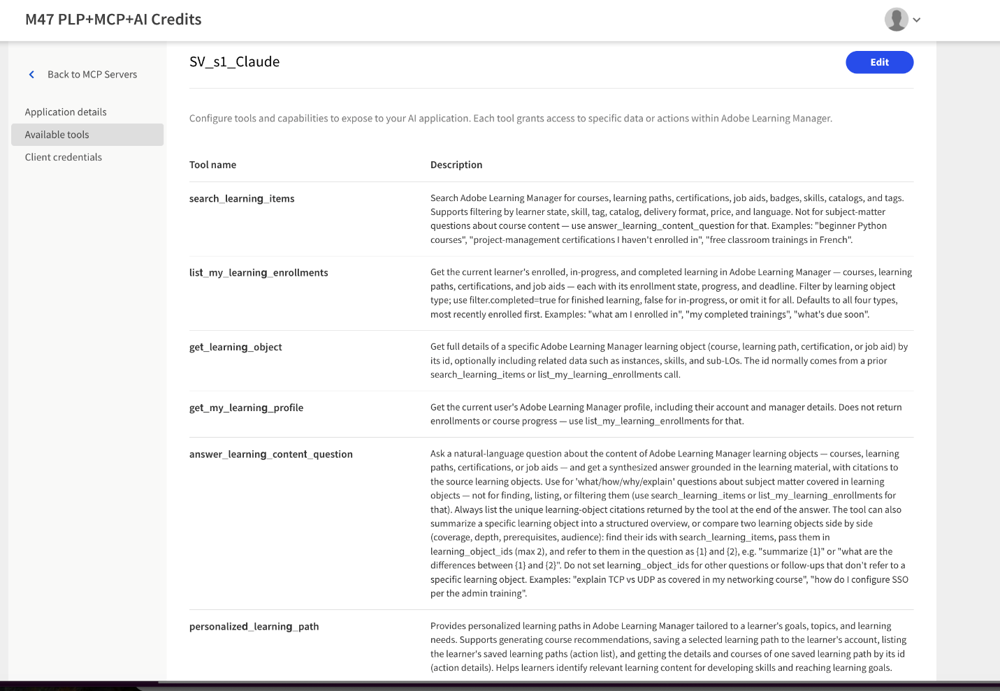

# Configuration d&#39;un serveur Model Context Protocol

## Présentation

Chaque serveur MCP enregistre une application cliente OAuth 2.0 qui autorise les clients IA à agir au nom de vos élèves. En tant qu’administrateur, vous créez le serveur et copiez ses informations d’identification, puis vous les donnez à l’administrateur du client AI, qui termine la connexion. Vous pouvez revenir sur un serveur à tout moment pour le modifier, affiner ses descriptions d’outils, copier ses informations d’identification ou le supprimer.

>[!NOTE]
>
>Le serveur fournit un accès en lecture seule aux utilisateurs avec le rôle Élève.

## Création du serveur MCP

1. Connectez-vous à Adobe Learning Manager en tant qu’administrateur.
2. Accédez à **IA dans Learning** > **Serveurs MCP**.
3. Sélectionnez **Nouveau serveur MCP**.
4. Saisissez les détails du serveur, y compris une description.

   * **Nom du serveur :** Saisissez un nom de 50 caractères maximum.
   * **Description :** entrez une brève description de 150 caractères maximum.
   * **URL :** entrez l&#39;URL de votre entreprise ou de votre application.
   * **Rediriger les domaines :** Entrez le domaine de chaque client IA qui se connectera, tel que [http://\*.chatgpt.com](https://encoded-592c9deb-987b-4562-aa3c-9fa3d37d83e9.uri/http%3a%2f%2f*.chatgpt.com) ou [http://\*.claude.ai](https://encoded-592c9deb-987b-4562-aa3c-9fa3d37d83e9.uri/http%3a%2f%2f*.claude.ai). Ce champ est obligatoire.

   

5. Sélectionnez **Suivant**.
6. Sur la page **Outils disponibles**, passez en revue les outils d&#39;élève exposés par le serveur. Fournir des descriptions détaillées, contextuelles et axées sur les objectifs pour les outils MCP.Fournir des descriptions contextuelles détaillées pour chaque outil. Une description précise permet aux clients compatibles avec MCP de sélectionner et d&#39;appeler l&#39;outil approprié. Indiquez l’objectif de l’outil, les tâches prises en charge, les entrées attendues et les cas d’utilisation typiques.

   

   Sélectionnez **Afficher** pour chaque outil afin d&#39;afficher les instructions permettant de déterminer quand l&#39;outil est sélectionné et comment l&#39;outil répond.

   

7. Sélectionnez **Informations d&#39;identification du client** dans le volet de navigation de gauche.
8. Copiez l&#39;**URL du point de terminaison MCP**, l&#39;**ID client** et la **clé secrète**. Sélectionnez **Copier** en regard de chaque valeur.

   

9. Sélectionnez **Fermer**.

>[!NOTE]
>
>Le serveur fournit un accès en lecture seule aux utilisateurs avec le rôle Élève.

Donnez l’URL du point de terminaison, l’ID client et la clé secrète à votre administrateur de client AI.

## Modification de la description d’un outil

Une description de l’outil indique au client AI quand sélectionner l’outil et comment l’outil répond. Vous pouvez également ajouter des exemples d’invite. Les descriptions d&#39;outils bien rédigées aident les clients compatibles avec MCP à découvrir et à appeler les outils appropriés avec plus de précision. Indiquez l’objectif de l’outil, les tâches prises en charge, les entrées attendues et les cas d’utilisation typiques.

1. Sur la page **Outils disponibles**, sélectionnez le menu **Actions** d&#39;un outil.
2. Sélectionnez **Configuration de l&#39;outil MCP** \> **Modifier**.

   

3. Dans la boîte de dialogue **Modifier l&#39;outil**, mettez à jour **Instructions/Description**.

   

4. Sous **Exemples d&#39;invites**, modifiez les invites. Pour ajouter une invite, sélectionnez **Ajouter un autre exemple**.
5. Sélectionnez **Enregistrer**.

Pour rétablir le libellé d&#39;origine d&#39;un outil, sélectionnez le menu **Actions** de l&#39;outil, puis sélectionnez **Configuration de l&#39;outil MCP** \> **Réinitialiser**.

## Modification d’un serveur MCP

1. Sélectionnez **IA dans Apprentissage** > **Serveurs MCP**.
2. Sélectionnez le nom du serveur.
3. Sélectionnez **Modifier**.
4. Mettez à jour les champs de la page **Détails de l&#39;application**, puis enregistrez vos modifications.

## Suppression d’un serveur MCP

1. Sélectionnez **IA dans Apprentissage** > **Serveurs MCP**.
2. Dans la ligne correspondant à votre serveur, sélectionnez le menu **Actions**.
3. Sélectionnez **Supprimer**.
4. Dans la boîte de dialogue de confirmation, sélectionnez **Supprimer**.

>[!WARNING]
>
>La suppression d’un serveur supprime l’accès à tous ses outils pour les applications d’IA connectées. Les sessions actives peuvent cesser de fonctionner immédiatement et vous ne pouvez pas annuler la suppression.

## Dépannage

**Les modifications d&#39;outil n&#39;apparaissent pas immédiatement.**
Les modifications apportées aux descriptions d’outils prennent un certain temps pour prendre effet. Attendez et réessayez.

**Un client AI a cessé de fonctionner après la suppression d&#39;un serveur.**
Créez un nouveau serveur et fournissez les nouvelles informations d’identification à votre administrateur de client AI.

**Le client AI utilise le mauvais outil.**
Passez en revue les descriptions d’outils que vous avez modifiées. Sélectionnez **Réinitialiser** pour restaurer le libellé d&#39;origine.

## Bonnes pratiques

* Conservez les descriptions d’outils d’origine, sauf si vous avez une raison particulière de les modifier.
* Rédigez des descriptions d’outils spécifiques et sans ambiguïté et des invites types lorsque vous les modifiez.
* Stockez la clé secrète en toute sécurité et partagez-la uniquement avec votre administrateur de client AI.
* Créez un serveur distinct pour chaque application d’IA, afin de pouvoir en révoquer une sans affecter les autres.
* Vérifiez qu’aucune application AI ne dépend d’un serveur avant de le supprimer.
