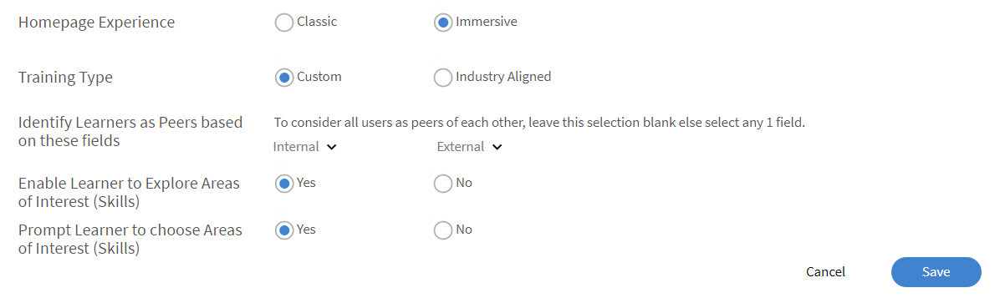
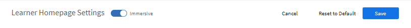
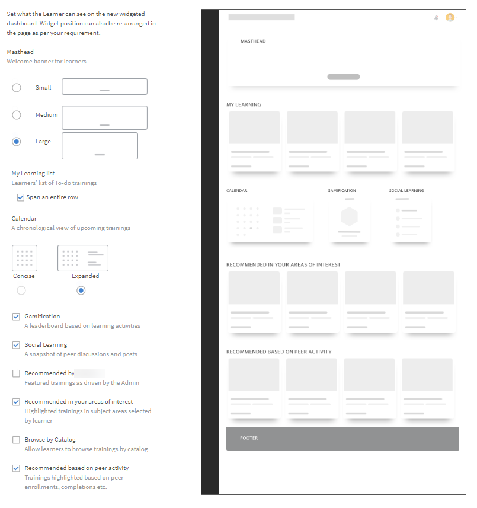
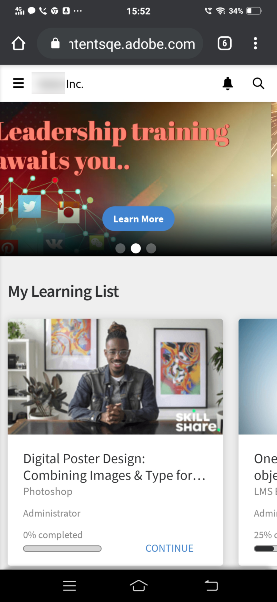
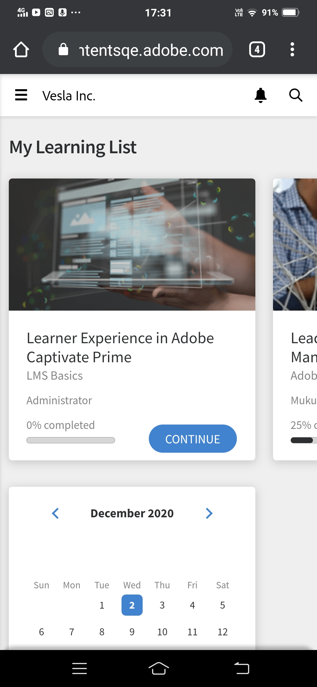
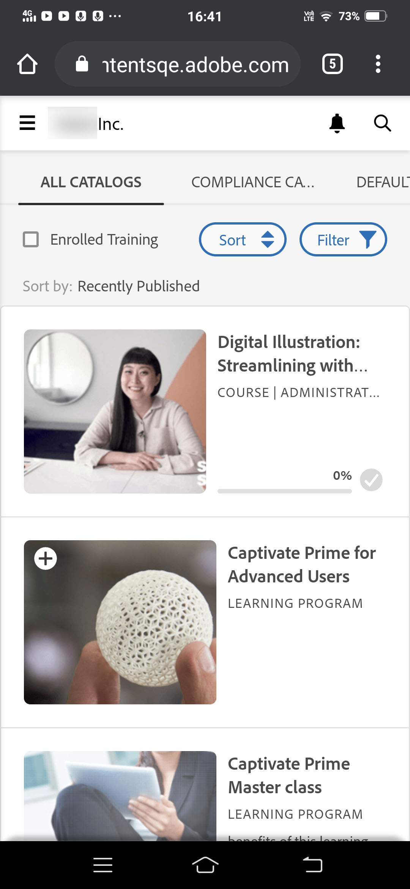
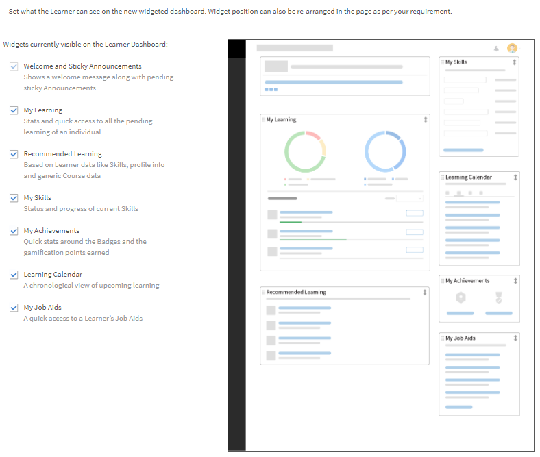

# Personnalisation de la page d’accueil des élèves

## Présentation {#overview}

Un administrateur peut personnaliser la page d’accueil de l’élève et la rendre plus moderne, plus axée sur le contenu et plus personnalisée pour l’élève.

L’approche personnalisée offre un moyen basé sur un widget de créer une page d’accueil des élèves, que l’administrateur de l’organisation peut configurer dans l’interface utilisateur d’administration de manière WYSIWYG.

L’expérience est basée sur des recommandations de formation personnalisées issues d’un algorithme basé sur l’IA qui analyse le contenu tiers en fonction des compétences du secteur, intègre l’activité des pairs et les centres d’intérêt des élèves à l’aide de données explicites et implicites.

### Personnalisation de la page d’accueil des élèves

Dans cette formation, vous découvrirez comment personnaliser la page d’accueil des élèves.

Si vous ne pouvez pas lancer la formation, écrivez à <almacademy@adobe.com>.

## Configuration de la page d’accueil des élèves {#configurethelearnerhomepage}

Sur la page **Identité visuelle** > **Page d&#39;accueil de l&#39;élève**, un administrateur peut personnaliser l&#39;expérience de la page d&#39;accueil d&#39;un élève, de sorte que lorsque l&#39;élève se connecte dans l&#39;application de l&#39;élève, il voit un aspect complètement remanié.

Les administrateurs peuvent définir l&#39;interface utilisateur (apparence et convivialité) à partir de l&#39;application d&#39;administration (onglet **Identité visuelle** > **Page d&#39;accueil de l&#39;élève**).

Les administrateurs peuvent passer en mode Widget d’interface utilisateur immersive, personnaliser les widgets/fonctions en conséquence, puis activer l’interface utilisateur immersive.

L’écran **Page d’accueil de l’élève** contient les sections suivantes :

## Option de mise en page immersive {#immersivelayoutoption}

Pour afficher la mise en page d’une page immersive, activez l’option **Immersive**. Vous pouvez activer/désactiver cette option dans **Identité visuelle > Général**.

Dans les versions précédentes, les options de la page d’accueil des élèves se trouvaient dans Paramètres.

Voici les options que vous pouvez définir :

**Expérience de la page d&#39;accueil :** activez **Classique** ou **Immersif**. Si vous choisissez Immersive, les options suivantes s’affichent :

* **Type de formation :** Choisissez **Secteur** ou **Aligné sur la base du profil personnalisé**. Les formations personnalisées sont créées sur place. Les formations axées sur le secteur d’activité comprennent du contenu standard provenant de fournisseurs tiers.

*Définissez l’expérience de la page d’accueil en sélectionnant Industrie ou Aligné personnalisé*

L&#39;option **Permettre à l&#39;élève d&#39;explorer les centres d&#39;intérêt** est disponible pour les expériences classiques et immersives.

<table>
 <tbody>
  <tr>
   <td>
    
<b>Si vous choisissez Personnalisée…</b>
</td>
   <td>
    
<b>Si vous choisissez Correspondant au secteur...</b> 
</td>
  </tr>
  <tr>
   <td>
    
Vous pouvez choisir au maximum un champ actif Interne et Externe.
</td>
   <td>
    
Vous pouvez choisir au minimum un et au maximum cinq champs. Par défaut, l’option <b>Profil</b> est sélectionnée.
</td>
  </tr>
 </tbody>
</table>

S’il y a moins de 1 000 élèves, l’ensemble du compte est considéré comme une seule étendue. Cette option est spécifique au type Formation personnalisée. Si le compte comporte moins de 1 000 utilisateurs, il considère que sa portée englobe l’intégralité du compte.

>[!NOTE]
>
>La case à cocher **Explorer les compétences** a été déplacée vers Paramètres > Général.

Elle est activée et grisée si l’expérience immersive est sélectionnée. Cette case à cocher n’est activée que pour l’expérience classique.

*Paramètres de la page d’accueil des élèves*

La mise en page immersive est la valeur par défaut pour tous les nouveaux comptes. La mise en page est contrôlée par des widgets qu’un administrateur peut activer ou désactiver. En fonction de la position des widgets, la même mise en page est reproduite sur la page d’accueil de l’élève.

Voici les widgets que vous pouvez activer/désactiver.

Vous pouvez ainsi prévisualiser l’interface utilisateur des élèves avant qu’elle ne soit en ligne.

Pour les comptes existants, l&#39;option **Immersive** sera **OFF**. Il est activé pour les nouveaux comptes avec Social et Ludification activés.

*Aperçu de l&#39;interface utilisateur de l&#39;élève*

<table>
 <tbody>
  <tr>
   <td>
    
<b>Widget</b>
</td>
   <td>
    
<b>Description</b>
</td>
  </tr>
  <tr>
   <td>
    
En-tête
</td>
   <td>
    
<b>Qu’est-ce qu’une en-tête et comment puis-je personnaliser l’en-tête des élèves ? </b> 

    
C’est une bannière de bienvenue pour les élèves. La bannière peut être une image ou une vidéo. Vous pouvez cibler des groupes d’utilisateurs spécifiques à l’aide de l’en-tête. Un élève voit l’en-tête dès qu’il atterrit sur la page d’accueil. Un groupe d’utilisateurs peut voir plusieurs images ou vidéos en vedette en fonction du plan cible défini par l’administrateur. 

    
Voici comment un administrateur charge une bannière :

    <ol>
     <li>Dans le panneau de gauche, cliquez sur <b>Annonces</b>. </li>
     <li>Cliquez sur <b>Ajouter</b> dans le coin supérieur droit de la page.</li>
     <li>Dans la liste déroulante <b>Type</b>, sélectionnez <b>Comme en-tête</b>.</li>
     <li>Écrivez un message qui apparaîtra dans l’en-tête.</li>
     <li>Chargez une image ou une vidéo.</li>
     <li>Sélectionnez le public cible. Sélectionnez un groupe d’utilisateurs ou une formation où l’en-tête sera affiché.</li>
     <li>Enregistrez l’annonce de l’en-tête.</li>
    </ol></td>
  </tr>
  <tr>
   <td>
    
Mon apprentissage
</td>
   <td>
    
Affiche les objets d’apprentissage, récemment consultés par l’élève. 
</td>
  </tr>
  <tr>
   <td>
    
Calendrier
</td>
   <td>
    
Affiche les différentes formations en classe et en classe virtuelle à venir pour les élèves chaque mois. Les classes auxquelles l’élève peut s’inscrire ou a déjà été inscrit sont affichées, y compris les formations approuvées par un responsable. 
</td>
  </tr>
  <tr>
   <td>
    
Inscriptions affichant une échéance
</td>
   <td>
    
Affiche les inscriptions en retard, dont les échéances sont proches ou qui sont en cours. 
</td>
  </tr>
  <tr>
   <td>
    
Ludification
</td>
   <td>
    
Affiche le tableau des scores basé sur les activités d’apprentissage.
</td>
  </tr>
  <tr>
   <td>
    
Apprentissage par les réseaux sociaux
</td>
   <td>
    
Répertorie les activités et les publications des utilisateurs qui se trouvent dans la même étendue utilisateur que l’élève. 
</td>
  </tr>
  <tr>
   <td>
    
Recommandé par l’organisation
</td>
   <td>
    
Lorsqu’il est activé, ce widget recommande des formations à des groupes d’utilisateurs spécifiques. Lorsqu’il est activé, ce widget recommande des formations à des groupes d’utilisateurs spécifiques. Chaque groupe d’utilisateurs peut cibler une ou plusieurs formations et le plan cible serait fondé sur un cadre de temps.  

    <ul>
     <li>
      
Tout d'abord, l'administrateur <a href="announcements.md#recommendation">crée une annonce</a> de type <b>Comme recommandation</b>, puis sélectionne la formation requise et utilise des groupes. Un stagiaire appartenant à un groupe d’utilisateurs pourra consulter la formation recommandée.
</li>
     <li>
      
Deuxièmement, l’administrateur peut également décider si les recommandations sont activées immédiatement ou à une date spécifiée.
</li>
    </ul></td>
  </tr>
  <!--
  <tr>
   <td>
    
Recommendation based on area of interest
</td>
   <td>
    
Displays Learning Objects based on the learner's chosen area of interest. The recommendation is driven by a Machine Learning algorithm.
</td>
  </tr>
  -->
  <tr>
   <td>
    
Parcourir par catalogue 
</td>
   <td>
    
Affiche les catalogues sous forme de mosaïques sur la page d’accueil. 
</td>
  </tr>
  <!--
  <tr>
   <td>
    
Recommendation based on peer activity 
</td>
   <td>
    
Displays training based on what a learner's peers are taking. This is again driven by a Machine Learning algorithm.
</td>
  </tr>
  -->
 </tbody>
</table>

Après avoir enregistré les modifications, la page d’accueil de l’élève reflète toutes les modifications.

Lorsque l’élève se connecte à l’application de l’élève via un navigateur, il peut voir la disposition immersive suivante :

<table>
 <tbody>
  <tr>
   <td>
    
<strong>Page d’accueil</strong>
</td>
   <td>
    
<strong>Liste Mon apprentissage</strong>
</td>
   <td>
    
<strong>Afficher le catalogue</strong>
</td>
  </tr>
 </tbody>
</table>

*Afficher la mise en page immersive pour différentes sections sur la page d&#39;accueil*

## Option de mise en page classique {#classiclayoutoption}

La mise en page de l’interface utilisateur qui a toujours existé jusqu’à présent est maintenant appelée mise en page classique. Lorsque vous choisissez cette option, la page d’accueil de l’élève revient à la mise en page classique.

*Aperçu de la mise en page classique*

## Configuration des paramètres de recommandation {#configurerecommendationsettings}

Sur **Identité visuelle** > **Général**, vous pouvez configurer la portée des recommandations pour les élèves internes et externes et permettre aux élèves de choisir des compétences sur la page d&#39;accueil de l&#39;élève.

Sur la page **Général**, vous disposez des options suivantes :

<table>
 <tbody>
  <tr>
   <td>
    
Nom de l’organisation
</td>
   <td>
    
Nom de l’organisation à laquelle appartient l’élève.
</td>
  </tr>
  <tr>
   <td>
    
Sous-domaine
</td>
   <td>
    
Sous-domaine de l’organisation.
</td>
  </tr>
  <tr>
   <td>
    
Style de logo
</td>
   <td>
    
Voici comment votre logo et le nom de votre société apparaîtront sur Learning Manager. 
</td>
  </tr>
  <tr>
   <td>
    
Thèmes
</td>
   <td>
    
Thème appliqué à Learning Manager.
</td>
  </tr>
  <tr>
   <td>
    
Personnaliser
</td>
   <td>
    
Adobe Learning Manager vous permet de personnaliser votre compte afin d’améliorer l’expérience de vos utilisateurs. 
</td>
  </tr>
  <tr>
   <td>
    
Page d’accueil de l’élève
</td>
   <td>
    
Sélectionnez <b>Classique </b>ou <b>Immersive</b>. Si vous choisissez Immersive, d’autres options s’affichent.
</td>
  </tr>
  <tr>
   <td>
    
Type de formation 
</td>
   <td>
    
Choisissez <b>Personnalisé </b>ou <b>Industrie alignée</b>. S’il y a moins de 1 000 élèves, l’ensemble du compte est considéré comme une seule étendue. La recommandation est basée sur tous les élèves. 
</td>
  </tr>
  <tr>
   <td>
    
Définition de la portée de la recommandation 
</td>
   <td>
    
Sélectionnez un ou plusieurs champs actifs. Pour <b>Personnalisé</b>, vous pouvez choisir au maximum un champ actif. Pour <b>Correspondant au secteur</b>, vous pouvez choisir au maximum cinq champs actifs. 
</td>
  </tr>
  <tr>
   <td>
    
Permettre à l’élève de découvrir les centres d’intérêt
</td>
   <td>
    
Applicable uniquement à l’expérience Classique. Choisissez <b>Oui </b>ou <b>Non</b>. 
</td>
  </tr>
  <tr>
   <td>
    
Inviter les utilisateurs à sélectionner des zones d’intérêt (compétences)  
</td>
   <td>
    
Applicable uniquement à l’expérience Immersive. Choisissez <b>Oui</b> ou <b>Non</b>.  
</td>
  </tr>
 </tbody>
</table>

>[!NOTE]
>
>Pour le nouveau compte, les paramètres Page d’accueil de l’élève, Type de formation et Portée de la recommandation ne seront pas visibles.

## Ajout et réorganisation de bandes de pages d’accueil dans Adobe Learning Manager {#add-reorder-homepage-strips}

Ajoutez des bandes Personnalisé le parcours d’apprentissage et Virtual Coach à la page d’accueil de l’élève, et faites glisser et déposez les bandes pour définir l’ordre dans lequel les élèves voient.

En tant qu’administrateur, vous pouvez ajouter des bandes de parcours d’apprentissage personnalisé (PLP) et de coach virtuel à la page d’accueil de l’élève dans Adobe Learning Manager. Vous pouvez également réorganiser chaque bande de page d&#39;accueil avec des commandes de glisser-déposer dans **Identité visuelle de l&#39;administrateur**. Vous pouvez désormais décider quelles bandes les élèves voient en premier.

Vous pouvez également ajouter un widget Parcours d’apprentissage personnalisé à une page personnalisée.

### À propos des bandes de la page d’accueil

Les bandes de la page d’accueil sont les widgets (cartes) qui apparaissent sur la page d’accueil de l’élève. Dans le branding d’administrateur, vous pouvez choisir les bandes à afficher et leur ordre d’apparition. Dans la version de décembre 2026 d’ALM, deux bandes alimentées par l’IA sont disponibles :

* **Bande de parcours d’apprentissage personnalisé :** met en évidence les parcours d’apprentissage générés par l’IA pour chaque élève.
* **Virtual Coach strip :** aide les élèves à trouver et à ouvrir des expériences de coaching à partir de la page d’accueil.

### Bande du parcours d’apprentissage personnalisé

Les élèves peuvent utiliser la bande pour :

* Accédez aux parcours d’apprentissage générés par l’IA.
* Continuer les parcours d’apprentissage précédemment générés.
* Découvrez les parcours d’apprentissage recommandés.

### Virtual Coach strip

Les élèves peuvent utiliser la bande pour :

* Découvrez les expériences de Virtual Coach.
* Reprendre les activités de coaching.
* Démarrez le coaching conversationnel d’IA à partir de la page d’accueil.

### Réorganiser les bandes de la page d’accueil

Vous pouvez placer n’importe quelle bande dans n’importe quelle position. Par exemple, vous pouvez d&#39;abord afficher la bande de l&#39;entraîneur virtuel, puis les bandes des parcours d&#39;apprentissage personnalisés, **Recommandé** et **Catalogue**, puis **Récemment consultés**.

1. Dans l&#39;application administrateur, sélectionnez **Identité visuelle** dans le volet de navigation de gauche.
2. Sélectionnez **Page D&#39;Accueil De L&#39;Élève**.
3. Dans la liste des bandes, recherchez la bande à déplacer.
4. Faites glisser la bande vers sa nouvelle position.

   

5. Enregistrez vos modifications.

Après la publication, le nouvel ordre apparaît sur la page d’accueil de l’élève.

>[!NOTE]
>
>Si le parcours d’apprentissage personnalisé ou la formation virtuelle ne figure pas dans la liste, assurez-vous qu’il est ajouté à la configuration de la page d’accueil avant de réorganiser.

## Ajout d’un widget Parcours d’apprentissage personnalisé à une page personnalisée

Vous pouvez utiliser le widget Parcours d’apprentissage personnalisé en dehors de la page d’accueil. Ajoutez-le à une page personnalisée pour donner aux élèves un endroit dédié où trouver des recommandations d’apprentissage personnalisées.

1. Sélectionnez **Pages personnalisées**.
2. Créer une page ou modifier une page existante.
3. Ajoutez un widget **Parcours d’apprentissage personnalisé**.

   

   Vérifiez le widget.

   

4. Sélectionnez **Continuer**.
5. Ajoutez le titre et la description du widget.

   

6. Sélectionnez **Ajouter un widget**.
7. Enregistrez la page.
8. Publish de la page.
