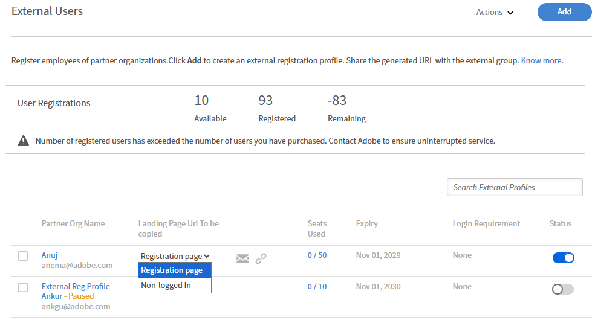

# Utilisation d’une URL de menu non connectée pour l’auto-inscription

Les profils d’auto-inscription permettent aux utilisateurs externes, tels que les partenaires ou les membres de plusieurs organisations, de créer leurs propres comptes dans Adobe Learning Manager. Vous pouvez désormais partager une URL de menu non connectée pour chaque profil d’auto-inscription. Le menu est intégré à Experience Builder.

Lorsque les utilisateurs sélectionnent **S&#39;abonner** à partir d&#39;une page accessible via cette URL, Adobe Learning Manager les ajoute au profil auquel appartient l&#39;URL. Cela vous permet de conserver les utilisateurs de différentes organisations, telles que différentes agences ou sociétés partenaires, dans des profils distincts.

Auparavant, une URL de page non connectée ajoutait toujours de nouveaux utilisateurs au profil sélectionné dans **Identité visuelle**. L’URL du menu hors connexion supprime cette limitation : chaque profil a sa propre URL et toutes les URL ouvrent la même page de destination.

## Avant de commencer

1. Créez le menu hors connexion dans Experience Builder et sélectionnez la page de destination dans **Identité visuelle**. Toutes les URL de profil ouvrent cette page de destination.

1. Créez le profil d&#39;auto-inscription dans **Utilisateurs** > **Externe**. Chaque profil possède son propre ID de groupe et sa propre clé d’accès, que les utilisateurs doivent enregistrer.

## Copie de l’URL d’inscription d’un profil

1. Sélectionnez **Utilisateurs** > **Externes**, puis sélectionnez **Auto-inscription**.

1. Dans la colonne **URL de la page d&#39;accueil à copier**, sélectionnez **Non connecté** pour un profil.

   

1. Copiez l’URL et partagez-la avec les utilisateurs que vous souhaitez inviter.

La liste **URL de la page de destination à copier** inclut les options suivantes :

* **Inscription** : URL d&#39;inscription standard
* **Page d&#39;accueil non connectée (héritée)** : URL de la page d&#39;accueil non connectée héritée
* **Menu hors connexion** : URL du menu hors connexion dans Experience Builder.

## Ce que les utilisateurs voient

1. L&#39;utilisateur ouvre l&#39;URL et accède à la page de destination hors connexion sélectionnée dans **Identité visuelle**.

1. L&#39;utilisateur sélectionne **S&#39;abonner** et saisit l&#39;ID de groupe et la clé d&#39;accès pour le profil.

1. L’utilisateur saisit son nom, son adresse e-mail et son mot de passe, puis termine son inscription.

Adobe Learning Manager ajoute l’utilisateur au profil auquel l’URL appartient. Vous pouvez voir le nouvel utilisateur sous ce profil dans **Utilisateurs** > **Externe**.

>[!NOTE]
>
>Chaque URL de profil affiche la même page de destination. Seul le profil auquel les utilisateurs sont ajoutés diffère.

## Envoyer un e-mail de bienvenue avec l’URL

1. Sélectionnez **Utilisateurs** > **Externe** et sélectionnez le profil d&#39;auto-inscription.

1. Dans la liste **URL de la page d&#39;accueil à copier**, sélectionnez l&#39;URL que vous souhaitez inclure dans l&#39;e-mail.

   

1. Sélectionnez l’icône de courrier électronique pour envoyer le courrier électronique. Vous pouvez également sélectionner l’icône de copie pour copier l’URL.

Adobe Learning Manager envoie l’e-mail à l’aide du modèle **Profil créé (externe/Partenaires)**. L’e-mail contient l’URL unique que vous avez sélectionnée, la limite de places pour le profil et la date d’expiration de l’URL. Partagez l’URL avec les utilisateurs à inviter.

## Passer de la page d’accueil héritée sans connexion

Les versions antérieures de cette liste affichaient l&#39;option **Non connecté**. Elle s&#39;appelle désormais **Page d&#39;accueil non connectée (héritée)**.

La page d’accueil héritée sans connexion sera obsolète dans une prochaine version. Si vous l’utilisez, passez au menu hors connexion dans Experience Builder pour conserver les mêmes fonctionnalités.
