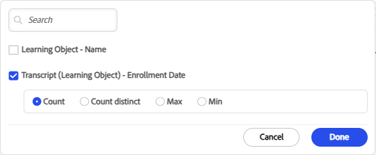
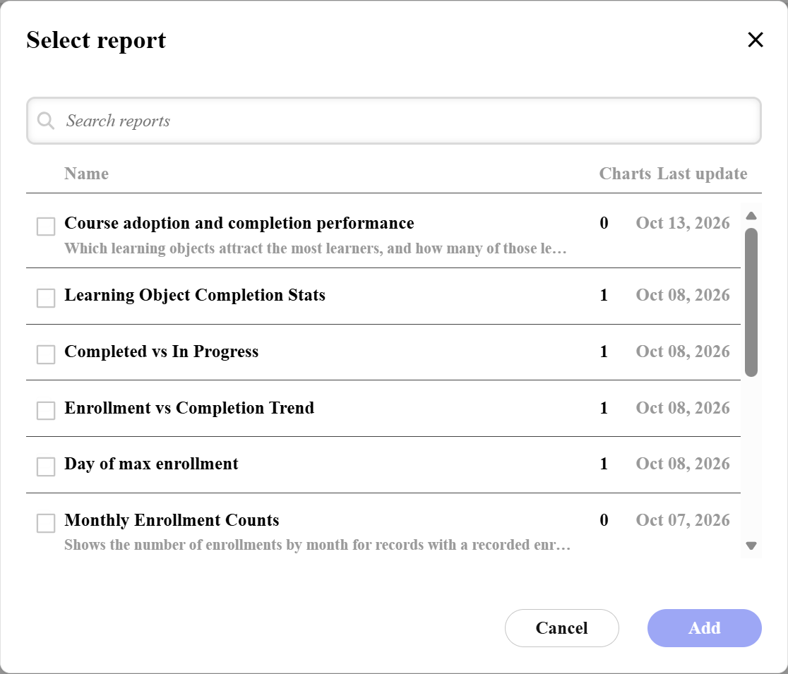
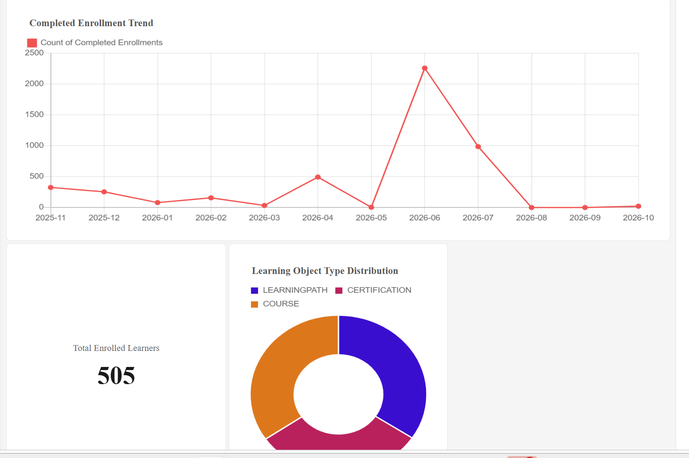

# Visualisations dans Report Builder

Les visualisations dans le Report Builder Adobe Learning Manager transforment un rapport enregistré en graphiques et tableaux de bord. Vous pouvez comparer des groupes, repérer des tendances et partager des résultats sans modifier les données dans un tableur.

>[!IMPORTANT]
>
>Les visualisations (graphiques et tableaux de bord) dans Report Builder sont disponibles uniquement pour les clients Adobe Learning Manager Ultimate. Ils ne sont pas disponibles avec l’édition Prime.

## À propos des visualisations dans Report Builder {#about-visualizations}

Une visualisation est un graphique ou un tableau de bord de graphiques créé à partir d’un rapport enregistré dans Report Builder. Vous choisissez les colonnes du rapport à tracer, et Report Builder dessine le graphique à partir des données du rapport. Vous pouvez tracer les colonnes directement ou tracer les données résumées à partir d&#39;un rapport.

* **Créer des graphiques pour un rapport :** ouvrez le rapport, sélectionnez **Visualisation** et créez des graphiques. Voir [Créer un graphique à partir d&#39;un rapport](#create-chart-from-report).
* **Regrouper les graphiques sur un tableau de bord :** choisissez les rapports comme source de données, puis ajoutez des graphiques à partir de ceux-ci. Voir [Créer un tableau de bord](#build-dashboard).
* **Partager et afficher :** partagez un tableau de bord avec les administrateurs, qui l&#39;affichent et le filtrent en mode lecture seule.

Les graphiques fonctionnent dans deux modes :

* **Mode de configuration :** vous créez ou modifiez le graphique.
* **Mode d&#39;affichage :** Vous pouvez filtrer ce que le graphique affiche sans modifier sa construction.

## Types de graphiques et quand les utiliser {#chart-types}

Choisissez le type de graphique en fonction de la question à laquelle vous souhaitez répondre.

| Type de graphique | Utilisez-le pour | Exemple |
|---|---|---|
| Ligne | Montre l’évolution d’une valeur dans le temps. | Inscriptions par mois de création |
| Barre ou colonne | Comparez les valeurs entre les catégories. Les mises en page groupées, empilées et empilées à 100 % sont disponibles. | Élèves par statut d&#39;inscription |
| Secteurs | Afficher la part de chaque catégorie dans un ensemble. Les segments inférieurs à 1 % sont regroupés dans un segment **Autres**. | Inscriptions par catalogue |
| Grand nombre | Mettez en surbrillance une mesure clé. | Nombre total d&#39;achèvements ce trimestre |
| Tableau | Afficher les valeurs exactes. Vous pouvez choisir un sous-ensemble de colonnes et afficher une colonne de date sous forme de lignes au lieu de colonnes (vue colonne par ligne). | Temps d’apprentissage passé par utilisateur, par mois |

>[!NOTE]
>
>Les graphiques linéaires créés à partir des rapports de tendance, tels que les inscriptions par mois, affichent l&#39;instantané actuel de vos données regroupées par date. Ils ne montrent pas comment les données ont été examinées à chaque date passée. Pour plus d’informations, voir Concepts et terminologie de Report Builder.

## Conditions de visualisation {#visualization-terms}

| Terme | Signification |
|---|---|
| Rapport | Une configuration de Report Builder enregistrée de colonnes, de filtres et de regroupements. Les graphiques sont construits à partir de rapports. |
| Filtre au niveau du graphique | Filtre défini lors de la création ou de la modification d&#39;un graphique. Il limite les données tracées par le graphique. |
| Filtre au niveau de la page | Un filtre appliqué à tous les graphiques d&#39;une page ou d&#39;un tableau de bord. Il peut restreindre, mais pas élargir, les propres filtres du rapport. |
| tableau de bord de Report Builder | Une page de graphiques que vous créez dans Report Builder. |

## Création d’un graphique à partir d’un rapport {#create-chart-from-report}

Créez un graphique à partir d&#39;un rapport enregistré pour afficher d&#39;un seul coup d&#39;œil les données d&#39;inscription, d&#39;achèvement ou de temps passé. Vous configurez le graphique une fois, et il est extrait de vos données de rapport chaque fois que vous l&#39;ouvrez.

### Avant de créer un graphique {#before-you-create-chart}

Confirmez ce qui suit :

* **Enregistrez le rapport.** L’option permettant d’ajouter un graphique apparaît sur la page de Report Builder après l’enregistrement du rapport.
* **Utilisez votre propre rapport.** Dupliquez un rapport partagé pour créer votre propre copie, puis utilisez-le pour créer des graphiques.
* **Vérifier la taille.** Impossible de tracer un rapport de plus de 10 millions de lignes. Un rapport résumé avec plus de 10 000 points de données n&#39;est pas tracé. Voir Limites des graphiques et des tableaux de bord.
* **Optimiser les données pour la visualisation.** Appliquez les filtres appropriés au niveau du rapport ou du graphique pour limiter la quantité de données tracées. Le temps nécessaire pour charger un graphique dépend de facteurs tels que le volume des données du rapport, la plage de dates sélectionnée et la combinaison de jeux de données et de tables utilisée dans le rapport. Le chargement des rapports qui traitent de gros volumes de données ou des combinaisons complexes de jeux de données peut prendre plus de temps ou peut expirer. Si cela se produit, réduisez les filtres ou la plage de dates et réessayez.
* **Connaître vos colonnes.** L&#39;axe X (dimension) et l&#39;axe Y (mesure) du graphique proviennent des colonnes de votre rapport. Pour résumer le rapport lui-même, utilisez **Grouper par** et les agrégats. Pour plus d&#39;informations, voir Application de groupes par et d&#39;agrégations.

### Configuration d&#39;un graphique {#configure-chart}

1. Connectez-vous à Adobe Learning Manager en tant qu’administrateur.
1. Sélectionnez **Rapports**, puis **Report Builder**.
1. Sélectionnez l&#39;onglet **Rapports**, puis ouvrez un rapport enregistré. Pour cet exemple, sélectionnez un rapport de tendance de connexion utilisateur, qui affiche le nombre d&#39;utilisateurs qui se sont connectés à la plateforme d&#39;apprentissage à chaque date.
1. Dans le volet de navigation de gauche, sélectionnez **Visualisation**. Un panneau s&#39;ouvre avec les onglets **Configuration** et **Style**.

   

   >[!NOTE]
   >
   >Une fois qu&#39;un graphique existe, sélectionnez **Modifier**, puis **+** pour ajouter un autre graphique.

1. Dans **Type de graphique**, sélectionnez un type, tel que **Graphique en courbes**. Ce champ est obligatoire.
1. En regard de **Dimension - Axe X**, sélectionnez l&#39;icône d&#39;ajout, puis sélectionnez la colonne de rapport. Pour une colonne de date, sélectionnez également une **granularité de date**, telle que jour ou mois.

   {width="650"}

1. Sélectionnez **Ajouter** pour ajouter la dimension de date.
1. En regard de **Mesure - Axe Y**, sélectionnez l&#39;icône d&#39;ajout, puis sélectionnez la colonne de rapport et la manière de l&#39;agréger, telle que **Nombre**.

   {width="650"}

1. Sélectionnez **Ajouter** pour ajouter la mesure.
1. (Facultatif) Sélectionnez **Ajouter un filtre** pour limiter les données tracées à une plage, par exemple les 30 derniers jours. Sélectionnez **Ajouter**.

   {width="650"}

1. (Facultatif) Ajoutez une colonne **Trier**, puis sélectionnez **Croissant** ou **Décroissant**. Sélectionnez **Ajouter**.

   {width="650"}

1. (Facultatif) Pour un graphique en courbes, définissez **Gestion des espaces** pour les données manquantes. Voir [Gestion des espaces pour les données manquantes](#gap-handling).
1. Dans **Nombre maximum de points de données**, entrez le nombre de points de données à tracer sur le graphique. La valeur par défaut est de 100 points et la limite est de 10 000.
1. Activez **Regrouper les autres points en tant qu&#39;« autres »**. Report Builder affiche des points de données individuels jusqu&#39;à la valeur **Max. de points de données** et regroupe tout ce qui dépasse cette limite dans une catégorie supplémentaire appelée **Autres**.

   Par exemple, si **Nombre maximum de points de données** est égal à 150 et que votre requête renvoie 200 points :

   * Report Builder affiche 150 points individuellement.
   * Report Builder combine les 50 points restants en **Autres**.
   * Le graphique montre 151 points tracés : 150 plus **autres**.

1. Sélectionnez **Suivant**. Vous pouvez désormais personnaliser votre graphique.

   {width="650"}

#### Gestion des espaces pour les données manquantes {#gap-handling}

La gestion des espaces définit ce que fait le graphique lorsqu&#39;une ou plusieurs observations d&#39;une série n&#39;ont pas de valeur numérique, par exemple NULL, NA, NaN ou une cellule vide.

Supposons que les données soient :

| X | Valeur |
|---|---|
| Jan | 10 |
| Fév | 15 |
| Mar | Sans objet |
| Avr | Sans objet |
| Mai | 25 |

Le tableau suivant présente les trois comportements.

| Gestion des écarts | Résultat conceptuel | Mode de traçage |
|---|---|---|
| Ligne à zéro | `10 -> 15 -> 0 -> 0 -> 25` | Traite les valeurs manquantes comme 0. |
| Ignorer | `10 -> 15   25` | Ne trace pas les points manquants et casse la ligne. |
| Connexion | `10 -> 15 ----> 25` | Ne trace pas les points manquants, mais relie les observations valides de chaque côté. |

>[!NOTE]
>
>La connexion n’est pas une interpolation. S’il manque mars et avril, le fait de relier février directement à mai ne fait que tracer une ligne visuelle entre les deux valeurs connues. Il ne crée pas de valeurs réelles pour les mois de mars et avril.

### Personnalisation du graphique {#customize-chart}

Personnaliser un graphique pour le rendre clair et facile à lire. Dans l&#39;onglet **Style**, vous pouvez ajouter un titre, afficher ou masquer les titres et légendes d&#39;axe, positionner et aligner la légende et définir une couleur pour chaque série. Les modifications de style affectent uniquement l&#39;aspect du graphique. Ils ne changent pas les données qu&#39;ils tracent.

1. Pour afficher un titre au-dessus du graphique, sélectionnez **Afficher le titre du graphique**. Pour le masquer, désactivez l’option.
1. Dans **Titre du graphique**, saisissez un titre pour le graphique.
1. Sélectionnez **Afficher le titre pour l&#39;Axe X** et **Afficher le titre pour l&#39;Axe Y** pour étiqueter les axes.
1. Pour afficher une touche qui identifie chaque ligne, sélectionnez **Afficher les légendes**.
1. Dans **Position de la légende**, sélectionnez l&#39;icône gauche, centrale ou droite pour aligner la légende.
1. Sous **Couleur de ligne**, sélectionnez l&#39;échantillon de couleur en regard d&#39;une série, tel que **Nombre d&#39;utilisateurs**.
1. Dans le sélecteur de couleurs, choisissez une couleur dans la palette ou utilisez l’onglet personnalisé pour définir la vôtre.
1. Répétez les deux étapes précédentes pour chaque ligne à redéfinir les couleurs.
1. Sélectionnez **Créer** pour ajouter le graphique. Si vous modifiez un graphique existant, sélectionnez **Enregistrer**.

   {width="650"}

Le graphique s’affiche avec vos titres, votre légende et les couleurs de la ligne.

>[!TIP]
>
>* Choisissez des couleurs qui contrastent nettement entre elles et avec l’arrière-plan. Conservez les titres et la légende pour que la couleur ne soit pas le seul moyen de distinguer les lignes.
>* Les options **Position de la légende**, **Alignement de la légende** et **Couleur de ligne** s&#39;appliquent uniquement lorsque l&#39;option **Afficher les légendes** est activée.
>* Chaque ligne du graphique possède sa propre nuance, une par mesure ajoutée dans l&#39;onglet **Configuration**.

Pour organiser les graphiques sur une seule page, voir [Créer un tableau de bord](#build-dashboard).

## Création d’un graphique en secteurs {#create-pie-chart}

Utilisez un graphique en secteurs pour montrer comment un tout se divise en plusieurs parties, comme la part des employés qui ont suivi une formation obligatoire ou la combinaison des formats de cours. Chaque tranche affiche la part d’une catégorie dans le total.

### À propos des graphiques en secteurs {#about-pie-charts}

Un graphique en secteurs dessine une tranche par catégorie. La taille de la tranche indique la part de cette catégorie dans la mesure totale. Une légende identifie chaque tranche, qui indique sa valeur.

Utilisez un graphique en secteurs pour afficher des parties d’un ensemble sur plusieurs catégories, lorsque les utilisateurs ont besoin de proportions supérieures à des valeurs exactes. Pour comparer plusieurs catégories, utilisez un graphique à barres. Pour afficher les variations dans le temps, utilisez un graphique linéaire.

### Étapes pour créer un graphique en secteurs {#pie-chart-steps}

Avant de commencer, enregistrez un rapport que vous possédez. Incluez une colonne pour les catégories et une colonne pour les mesures.

1. Sélectionnez **Rapports**, puis **Report Builder**. Dans l&#39;onglet **Rapports**, ouvrez le rapport enregistré.
1. Dans le volet de navigation de gauche, sélectionnez **Visualisation**.
1. Dans **Type de graphique**, sélectionnez **Graphique à secteurs**.
1. En regard de **Dimension - Segment**, sélectionnez l&#39;icône d&#39;ajout, puis sélectionnez la colonne qui définit les tranches. Par exemple, sélectionnez **Transcription (objet d’apprentissage) - État**.
1. En regard de **Mesurer - Valeur**, sélectionnez l&#39;icône d&#39;ajout, puis sélectionnez la colonne et agrégez les tranches de cette taille, par exemple **Nombre**.
1. (Facultatif) Dans **Nombre maximum de points de données**, entrez le nombre maximal de tranches à dessiner. La valeur par défaut est 100.
1. (Facultatif) Pour combiner des catégories mineures, activez **Grouper le reste des points comme « autres »**.
1. Sélectionnez **Suivant** pour personnaliser le graphique en secteurs.

### Personnalisation du graphique en secteurs {#customize-pie-chart}

1. Pour afficher un titre, activez **Afficher le titre du graphique**. Désactivez-la pour masquer le titre.
1. Dans **Titre du graphique**, saisissez un titre, tel que `Mandatory Compliance Completion`.
1. Dans le **style de graphique**, sélectionnez **secteur** pour un cercle plein ou **anneau** pour un anneau.
1. Sélectionnez **Afficher les légendes** pour afficher la légende sur le graphique.
1. Dans **Position de la légende**, sélectionnez l&#39;emplacement où la légende apparaît.
1. Dans **Alignement de la légende**, sélectionnez gauche, centre ou droite.
1. Sélectionnez **Créer** pour un nouveau graphique. Lorsque vous modifiez un graphique existant, sélectionnez **Enregistrer**, puis **Enregistrer** sur la page **Visualisation**.

   {width="650"}

Report Builder crée le graphique en secteurs ou en anneau.

## Création d’un graphique à barres {#create-bar-chart}

Utilisez un graphique à barres pour comparer une mesure entre des catégories, telles que le statut de la formation par équipe ou le temps d&#39;apprentissage par client. Les barres sont faciles à comparer et à classer, et vous pouvez les regrouper ou les mettre en pile pour ajouter une deuxième ventilation.

### À propos des graphiques à barres {#about-bar-charts}

Un graphique à barres trace une barre pour chaque catégorie sur l’axe X. La longueur de la barre affiche la mesure sur l’axe Y, comme le nombre d’élèves. Vous pouvez dessiner des barres verticalement (colonnes) ou horizontalement.

Utilisez un graphique à barres pour :

* Comparez les valeurs entre les catégories, telles que les équipes, les partenaires ou les clients.
* Classez les catégories du plus élevé au plus bas.
* Indiquez une deuxième ventilation dans chaque barre, par exemple le statut de chaque partenaire.

### Avant de créer un graphique à barres {#before-you-create-bar-chart}

* Enregistrez le rapport et utilisez un rapport dont vous êtes propriétaire.
* Incluez une colonne pour les catégories et une colonne pour mesurer.
* Conserver le rapport dans les limites indiquées dans les limites du graphique et du tableau de bord.

### Procédure de création d’un graphique à barres {#bar-chart-steps}

1. Sélectionnez **Rapports**, puis **Report Builder**. Dans l&#39;onglet **Rapports**, ouvrez le rapport enregistré.
1. Dans le volet de navigation de gauche, sélectionnez **Visualisation**.
1. Dans **Type de graphique**, sélectionnez **Graphique à barres**.
1. En regard de **Dimension - Axe X**, sélectionnez l&#39;icône d&#39;ajout, puis sélectionnez la colonne qui définit les catégories. Sélectionnez **Terminé**.

   {width="650"}

1. En regard de **Mesure - Axe Y**, sélectionnez l&#39;icône d&#39;ajout, puis sélectionnez la colonne et la manière de l&#39;agréger, comme **Nombre**. Sélectionnez **Terminé**.

   {width="650"}

1. (Facultatif) Ajoutez des **filtres** pour limiter les données et définissez **Trier** pour classer les barres par colonne.
1. Dans **Nombre maximal de points de données**, entrez le nombre maximal de points de données à tracer. Si vous saisissez 150, Report Builder affiche jusqu&#39;à 150 points de données individuels et regroupe tout ce qui dépasse cette limite dans une catégorie supplémentaire appelée **Autres**.
1. Sélectionnez **Suivant** pour personnaliser le graphique à barres.

### Personnalisation du graphique à barres {#customize-bar-chart}

Utilisez l&#39;onglet **Style** pour définir le titre, l&#39;orientation, le regroupement, la légende et les couleurs. Les paramètres de style modifient l&#39;aspect du graphique et non les données qu&#39;il trace.

1. Sélectionnez l&#39;onglet **Style**.
1. Pour afficher un titre, activez **Afficher le titre du graphique**. Dans **Titre du graphique**, saisissez un titre, tel que `Most Popular Courses`.
1. Pour étiqueter les axes, activez **Afficher le titre pour X Axe** et **Afficher le titre pour Y Axe**. Désactivez une option pour masquer ce titre.
1. Dans **Style de graphique**, sélectionnez **Vertical** pour les colonnes ou **Horizontal** pour les barres latérales. Les barres horizontales laissent plus d’espace pour les noms de catégorie longs.
1. Dans **Regroupement des barres**, sélectionnez l&#39;une des trois icônes pour définir la façon dont plusieurs séries partagent une catégorie : groupée, empilée ou empilée à 100 %.
1. Pour identifier chaque série, activez **Afficher les légendes**.
1. Dans **Position de la légende**, sélectionnez l&#39;emplacement où la légende apparaît. Dans **Alignement de la légende**, sélectionnez gauche, centre ou droite.
1. Sous **Couleur de barre**, sélectionnez la nuance en regard d&#39;une série, puis choisissez une couleur.
1. Sélectionnez **Créer** pour un nouveau graphique. Lorsque vous modifiez un graphique existant, sélectionnez **Enregistrer**.

>[!NOTE]
>
>Le **regroupement des barres** n&#39;est important que lorsqu&#39;une barre comporte plusieurs séries, par exemple deux mesures. Gardez la légende allumée et affichez les étiquettes de données, pour que la couleur ne soit pas le seul moyen de distinguer les séries.

## Créer un grand nombre {#create-big-number}

Utilisez une valeur élevée pour afficher une mesure clé sous la forme d&#39;un grand chiffre facile à lire, comme le nombre total d&#39;élèves, d&#39;inscriptions en retard ou d&#39;utilisateurs actifs. Les grands nombres fonctionnent bien en haut d’un tableau de bord, où le spectateur vérifie d’abord les chiffres clés.

### À propos des grands nombres {#about-big-numbers}

Un grand nombre est une vignette en deux parties : une valeur et un libellé. La valeur est un nombre unique calculé à partir de votre état, tel qu&#39;un nombre ou une somme. Le libellé indique aux utilisateurs ce que signifie le nombre. Un grand nombre n’a pas d’axes, de légende ou de catégories.

Utilisez un grand nombre pour :

* Affichez un titre que quelqu&#39;un vérifie régulièrement.
* Donnez du contexte à un tableau de bord avant les graphiques détaillés situés en dessous.

### Étapes pour créer un grand nombre {#big-number-steps}

Avant de commencer, enregistrez un rapport que vous possédez. Choisissez le nombre à insérer, ainsi que la colonne et l’agrégat qui produisent le résultat.

Par exemple, les administrateurs de formation signalent chaque mois la quantité de formation terminée par l’organisation. Les dirigeants veulent une figure de titre, pas une liste d’inscriptions, et les administrateurs veulent l’actualiser sans reconstruire le rapport.

1. Sélectionnez **Rapports**, puis **Report Builder**. Dans l&#39;onglet **Rapports**, ouvrez le rapport enregistré.
1. Dans le volet de navigation de gauche, sélectionnez **Visualisation**.
1. Dans **Type de graphique**, sélectionnez **Grand nombre**.
1. Dans **Mesurer - Valeur**, sélectionnez **Transcription (objet d&#39;apprentissage) - État**, puis appliquez l&#39;agrégation **Nombre**. Sélectionnez **Terminé**.

   {width="650"}

1. Sélectionnez le nombre de chiffres à afficher après la virgule décimale. Vous pouvez sélectionner au maximum deux chiffres.
1. Dans **Unité d&#39;affichage**, sélectionnez la manière dont les nombres importants sont raccourcis. Sélectionnez **K** pour des milliers, **M** pour des millions, **B** pour des milliards ou **Aucun** pour afficher la valeur complète. **Auto** sélectionne automatiquement l&#39;unité appropriée. Sélectionnez **Suivant**.

   {width="650"}

### Personnalisation du grand nombre {#customize-big-number}

Utilisez l&#39;onglet **Style** pour personnaliser les propriétés de légende du grand nombre.

1. Dans **Titre de la légende**, saisissez le texte qui nomme le numéro. Par exemple, saisissez `Total Course Completions`.
1. Dans **Position de la légende**, sélectionnez l&#39;une des deux icônes pour définir l&#39;emplacement du titre.
1. Dans **Alignement de la légende**, sélectionnez gauche, centre ou droite.
1. Sélectionnez **Créer** pour un nouveau graphique. Lorsque vous modifiez un graphique existant, sélectionnez **Enregistrer**.

   {width="650"}

## Création d&#39;un tableau ou d&#39;un graphique à pivot {#create-table-pivot-chart}

Utilisez un tableau croisé dynamique pour résumer un nombre dans deux catégories, par exemple le nombre d’élèves dans l’équipe de chaque responsable ayant terminé, commencé ou non commencé l’apprentissage requis. Vous pouvez également passer à une vue de style pivot, où les dates ou les catégories s&#39;étendent en haut du tableau, de sorte que chaque élève ou cours tienne sur une ligne.

### À propos des tableaux et des graphiques croisés dynamiques {#about-table-pivot}

Un tableau croisé dynamique est une grille avec une catégorie en bas, une catégorie en haut et un nombre dans chaque cellule. Chaque cellule affiche la mesure pour une valeur de ligne et une valeur de colonne. Vous le construisez avec trois paramètres dans l&#39;onglet **Configuration**.

| Paramètre | Ce qu’il fait | Dans l’exemple |
|---|---|---|
| **Dimension - Colonnes** | Les valeurs de ce champ deviennent les en-têtes de colonne en haut. | **Transcription (Objet D’Apprentissage) - État** : Terminé, En Cours, Pas Commencé |
| **Dimension - Lignes** | Les valeurs de ce champ deviennent les étiquettes de ligne en bas à gauche, une ligne pour chaque valeur. | **Utilisateur - Nom du responsable** |
| **Mesurer - Valeur** | Nombre dans chaque cellule. Vous choisissez une colonne et un agrégat, tel que **Count**. Il s&#39;affiche sous la forme du nom de la colonne suivi de **Agrégé par : nombre**. | Nombre d’élèves |

Une dimension est un champ par lequel vous effectuez un regroupement. Une mesure est un nombre que vous calculez.

### Avant de créer un graphique tabulaire {#before-you-create-table-chart}

* Pour utiliser l&#39;affichage colonne par ligne, regroupez l&#39;état en fonction de la colonne que vous souhaitez utiliser comme en-têtes, par exemple une date.
* Si vous effectuez un regroupement sur la base de plusieurs colonnes de date, vous en choisissez une pour les en-têtes.

### Étapes pour créer un graphique de tableau {#table-chart-steps}

1. Sélectionnez **Rapports**, puis **Report Builder**. Dans l&#39;onglet **Rapports**, ouvrez le rapport enregistré.
1. Dans le volet de navigation de gauche, sélectionnez **Visualisation**.
1. Dans **Type de graphique**, sélectionnez **Tableau/Pivot**.
1. En regard de **Dimension - Lignes**, sélectionnez l&#39;icône d&#39;ajout, puis sélectionnez **Utilisateur - Nom du responsable**.
1. En regard de **Dimension - Colonnes**, sélectionnez l’icône d’ajout, puis **Transcription (objet d’apprentissage) - État**.
1. En regard de **Mesurer - Valeur**, sélectionnez l&#39;icône d&#39;ajout. Sélectionnez la mesure **Transcription (objet d’apprentissage) - État**, puis sélectionnez **Ajouter**.

   {width="650"}

1. Activez l’une ou l’autre des options suivantes, ou les deux, en fonction de vos exigences de création de rapports :

   * **Afficher le total général pour les colonnes :** affiche le total général pour chaque colonne. Par exemple, si le tableau affiche les données des ventes dans différentes régions, le total général affiche le total des ventes de chaque colonne.
   * **Afficher le total général pour les lignes :** affiche le total général pour chaque ligne. Par exemple, si le tableau affiche les ventes mensuelles pour différents produits, le total général affiche le total des ventes pour chaque ligne.

1. Dans **Nombre de lignes à afficher (20 maximum)**, entrez le nombre de lignes à afficher simultanément dans le tableau. La valeur par défaut est 10 et la valeur maximale est 20. Par exemple, 15 affiche 15 lignes par page.
1. Sélectionnez **Suivant**.

### Personnalisation du tableau {#customize-table}

Utilisez l&#39;onglet **Style** pour ajouter le titre du graphique, colorer l&#39;en-tête du tableau et colorer les lignes du tableau.

1. Dans **Titre du graphique**, saisissez le titre que vous souhaitez afficher, tel que `Status of Learning`.
1. Sélectionnez **Couleur de ligne d&#39;en-tête** pour appliquer une couleur d&#39;arrière-plan à la ligne d&#39;en-tête.
1. Activez **Mettre en surbrillance les lignes alternatives** pour appliquer des couleurs alternées aux lignes afin de faciliter la lecture.
1. Sélectionnez **Couleur 1** et choisissez la première couleur pour les lignes en alternance.
1. Sélectionnez **Couleur 2**, puis choisissez la deuxième couleur pour les lignes en alternance.
1. Sélectionnez **Enregistrer** pour appliquer les paramètres de style au graphique.

## Création d’un tableau de bord {#build-dashboard}

Un tableau de bord place les graphiques d&#39;un ou plusieurs rapports sur une seule page. Construisez-en un lorsque vous répondez aux mêmes questions à plusieurs reprises, par exemple le nombre de personnes qui ont suivi la formation ce mois-ci ou les équipes qui sont en retard.

### À propos des tableaux de bord de Report Builder {#about-dashboards}

Un tableau de bord est une page de graphiques. Vous choisissez les rapports à partir desquels il est dessiné, appelez sa source de données, puis ajoutez des graphiques à partir de ces rapports. Les graphiques proviennent toujours de rapports. Vous devez donc les créer d&#39;abord sur la page **Visualisation** de chaque rapport. Vous ne pouvez utiliser que les rapports dont vous êtes propriétaire. La portée s&#39;applique à tous les graphiques du tableau de bord.

### Création du tableau de bord {#create-dashboard}

1. Sélectionnez **Rapports** > **Tableaux de bord**. La page répertorie tous les tableaux de bord que vous avez créés.
1. Sélectionnez **Créer un tableau de bord**.
1. Saisissez le nom et la description du tableau de bord.

   {width="650"}

1. Dans **Source de données**, sélectionnez **Ajouter un rapport** pour ajouter les graphiques précréés à partir des rapports disponibles.
1. Sélectionnez un ou plusieurs rapports dans la liste, puis sélectionnez **Ajouter**.

   {width="650"}

Report Builder ajoute les rapports au tableau de bord.

{width="650"}

### Afficher les graphiques dans le tableau de bord {#view-charts}

Sélectionnez **Graphiques** dans le volet de navigation gauche du tableau de bord.

Option {width="650"}

Tous les graphiques des rapports disponibles apparaissent sur le tableau de bord.

{width="650"}

### Déplacer des graphiques dans le tableau de bord {#move-charts}

1. Sélectionnez **Modifier** dans le coin supérieur droit du tableau de bord. Vous pouvez afficher les colonnes de chaque rapport qui ont été utilisées pour créer les graphiques. Vous pouvez également créer un autre graphique à ajouter au tableau de bord.

   {width="650"}

1. Dans le panneau de gauche, sélectionnez les graphiques à ajouter au tableau de bord.
1. Faites glisser chaque graphique vers la position souhaitée, puis relâchez-le pour placer le graphique.
1. Répétez l’étape précédente pour organiser les graphiques en fonction de vos exigences en matière de rapports.
1. Sélectionnez **Enregistrer** pour enregistrer toutes les modifications dans le tableau de bord.

### Partage d’un tableau de bord {#share-dashboard}

Partagez un tableau de bord de Report Builder avec d&#39;autres administrateurs afin qu&#39;ils puissent afficher les mêmes graphiques et données.

Les graphiques que vous créez à partir d’un rapport sont enregistrés avec ce rapport. Lorsque vous partagez le rapport, les autres administrateurs obtiennent également les graphiques. Partagez un tableau de bord une fois au lieu de demander à chaque administrateur de le reconstruire.

#### Partage d’un tableau de bord avec d’autres administrateurs {#share-with-administrators}

1. Connectez-vous à Adobe Learning Manager en tant qu’administrateur.
1. Sélectionnez **Rapports**, puis **Report Builder**.
1. Sélectionnez l&#39;onglet **Rapports**, puis ouvrez le rapport contenant le tableau de bord.
1. Sélectionnez **Actions** > **Partager**.
1. Sous **Partager**, sélectionnez **Modifier**.
1. Sélectionnez le champ **Sélectionner des utilisateurs/groupes d&#39;utilisateurs**.
1. Recherchez et sélectionnez les administrateurs ou les groupes d’utilisateurs avec lesquels vous souhaitez partager.

   {width="650"}

1. Sélectionnez **Enregistrer**.

Les administrateurs sélectionnés peuvent désormais afficher le rapport et ses graphiques dans leur vue de Report Builder.

>[!NOTE]
>
>Les administrateurs avec un accès partagé peuvent afficher, dupliquer et modifier le rapport.

#### Supprimer l’accès partagé {#remove-shared-access}

1. Ouvrez le rapport, puis sélectionnez **Actions** > **Partager**.
1. Sous **Partager**, sélectionnez **Modifier**.
1. Désélectionnez l’administrateur ou le groupe d’utilisateurs.
1. Sélectionnez **Enregistrer**.

#### Bonnes pratiques de partage {#sharing-best-practices}

* Partagez un rapport bien configuré au lieu de laisser chaque administrateur créer une variante. Cela permet de conserver une version faisant autorité des données.
* Créez le rapport avec des filtres qui s’appliquent à toutes les personnes avec lesquelles vous le partagez, afin que tous les utilisateurs voient des graphiques cohérents.

### Supprimer un tableau de bord {#delete-dashboard}

Supprimer un tableau de bord de Report Builder lorsque vous n’en avez plus besoin. La suppression d’un tableau de bord le supprime définitivement ainsi que les paramètres de partage associés. Cette action est irréversible.

1. Connectez-vous à Adobe Learning Manager en tant qu’administrateur.
1. Sélectionnez **Rapports**, puis **Report Builder**.
1. Sélectionnez l&#39;onglet **Rapports**, puis ouvrez le tableau de bord que vous souhaitez supprimer.
1. Sélectionnez **Actions** > **Supprimer**. La boîte de dialogue **Confirmation requise** s&#39;affiche. Le nom du tableau de bord et les utilisateurs avec lesquels il est partagé s’affichent.

   {width="650"}

1. Sélectionnez l’une des options suivantes :

   * **Modifier le partage :** vérifiez ou modifiez les utilisateurs avec lesquels le tableau de bord est partagé.
   * **Annuler :** fermez la boîte de dialogue sans supprimer le tableau de bord.
   * **Supprimer le tableau de bord :** supprimez définitivement le tableau de bord et ses paramètres de partage.