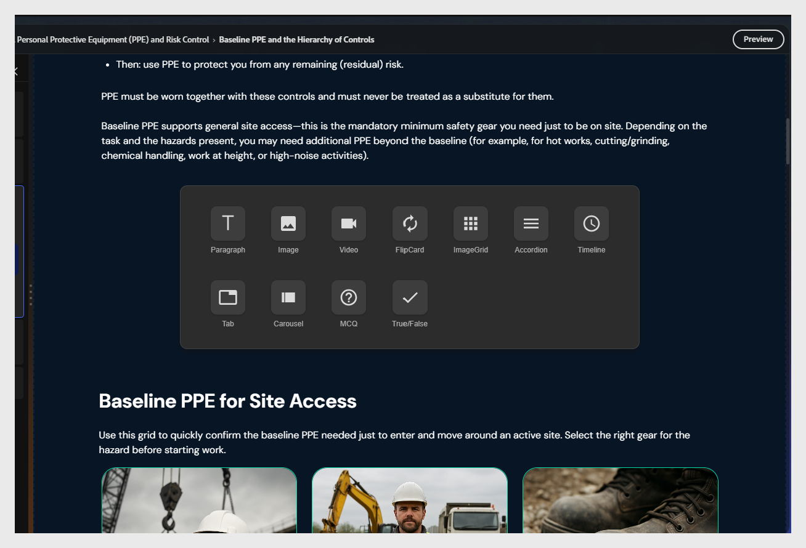
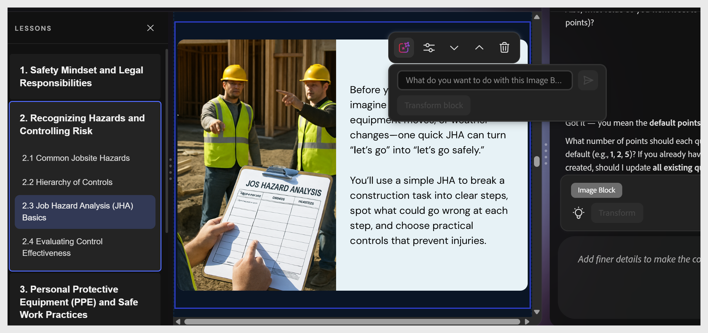

# Ajout d’un composant de contenu

Sélectionnez entre deux éléments existants. Le bouton + s’affiche. Sélectionnez-le pour ouvrir le sélecteur de composants.

Composants disponibles :

<table>
  <thead>
    <tr>
      <th>Composant</th>
      <th>Utiliser pour</th>
    </tr>
  </thead>
  <tbody>
    <tr>
      <td><strong>Paragraphe</strong></td>
      <td>Corps de texte et explications</td>
    </tr>
    <tr>
      <td><strong>Image</strong></td>
      <td>Illustrations, captures d’écran, diagrammes</td>
    </tr>
    <tr>
      <td><strong>Vidéo</strong></td>
      <td>Vidéo liée ou MP4 intégrée</td>
    </tr>
    <tr>
      <td><strong>Retourner la carte</strong></td>
      <td>Paires de termes ou de définitions, afficher les interactions</td>
    </tr>
    <tr>
      <td><strong>Grille de l’image</strong></td>
      <td>Plusieurs images dans une mise en page de grille</td>
    </tr>
    <tr>
      <td><strong>Accordéon</strong></td>
      <td>Sections extensibles, procédures étape par étape</td>
    </tr>
    <tr>
      <td><strong>Chronologie</strong></td>
      <td>Evénements séquentiels ou étapes de processus</td>
    </tr>
    <tr>
      <td><strong>Objet Web</strong></td>
      <td>Incorporer du contenu web externe, une page web, un outil interactif, une enquête ou une application web directement dans une diapositive de rubrique</td>
    </tr>
    <tr>
      <td><strong>Tabulation</strong></td>
      <td>Contenu parallèle — comparaisons, variantes régionales</td>
    </tr>
    <tr>
      <td><strong>Carrousel</strong></td>
      <td>Série d’images ou de cartes de contenu pouvant être balayées</td>
    </tr>
    <tr>
      <td><strong>MCQ</strong></td>
      <td>Vérification des connaissances non notée en ligne</td>
    </tr>
    <tr>
      <td><strong>Vrai/faux</strong></td>
      <td>Vérification True ou False intégrée</td>
    </tr>
  </tbody>
</table>

>[!NOTE]
>
>Utilisez **Accordéon** pour les procédures étape par étape où les élèves peuvent contrôler leur rythme. Utilisez **Flip Card** pour le contenu de terme ou de définition.

## Ajouter un objet Web à un cours du compositeur de contenu

Un objet Web affiche un contenu externe dans un cadre en ligne au sein du cours. Les élèves interagissent avec le contenu sans quitter le cours. Utilisez-le pour les outils interactifs, les formulaires intégrés, les enquêtes ou toute ressource web prenant en charge l’intégration iframe.

### Ajouter un objet Web

1. Ouvrez votre cours dans le compositeur de contenu et accédez à la rubrique dans laquelle vous souhaitez ajouter l’objet Web.
2. Sélectionnez entre deux éléments existants sur la diapositive de rubrique. Le bouton **+** apparaît.
3. Sélectionnez **+** pour ouvrir le sélecteur de composants.
4. Sélectionnez **Objet Web**. Le bloc apparaît sur la zone de travail.

### Configuration de l’objet Web

Sélectionnez l&#39;icône **Paramètres** dans la barre d&#39;outils du bloc d&#39;objet Web pour ouvrir le panneau de configuration.

### Définition de la source de contenu

Sous **Contenu**, sélectionnez le mode de chargement du contenu externe :

- **URL** : saisissez l&#39;adresse web de la page ou de l&#39;outil que vous souhaitez incorporer. Le contenu se charge à l’intérieur du cours dans un cadre intégré.
- **Incorporer le code** — collez un extrait de code incorporé à partir d&#39;un service tiers. Utilisez-le pour les outils fournissant leur propre code incorporé, tels que les formulaires interactifs, les enquêtes ou les lecteurs multimédias.
- **Système** : sélectionnez le contenu à partir d&#39;un système ou d&#39;une intégration connecté.

### Définition de l’height du cadre

Dans le champ **height du Cadre**, définissez l&#39;height du cadre de contenu incorporé en pixels. Utilisez les commandes **+** et **−** pour ajuster la valeur. La valeur par défaut est 498 px.

Ajustez l’height du cadre pour qu’il corresponde à l’height naturel du contenu incorporé. Une valeur trop basse ajoute une barre de défilement dans le cadre, tandis qu’une valeur trop élevée ajoute un espace vide sous le contenu.

### Configuration des options de chargement et d’affichage

- **Chargement automatique** : lorsque cette option est sélectionnée, le contenu web se charge automatiquement lorsqu&#39;un élève atteint la diapositive. Désactivez cette option pour les pages riches en contenu afin d’éviter de ralentir le cours. Lorsque le chargement automatique est désactivé, les élèves sélectionnent le cadre pour déclencher le chargement.
- **Titre du bloc** : activez cette option pour afficher un en-tête au-dessus du bloc d&#39;objet Web. Utilisez ceci pour donner aux élèves un contexte sur le contenu incorporé avant qu&#39;ils interagissent avec celui-ci.

## Déplacement de blocs de contenu dans une rubrique

Vous pouvez réorganiser les blocs de contenu d’une rubrique à l’aide des options de modification de la barre d’outils ou de l’IA.

