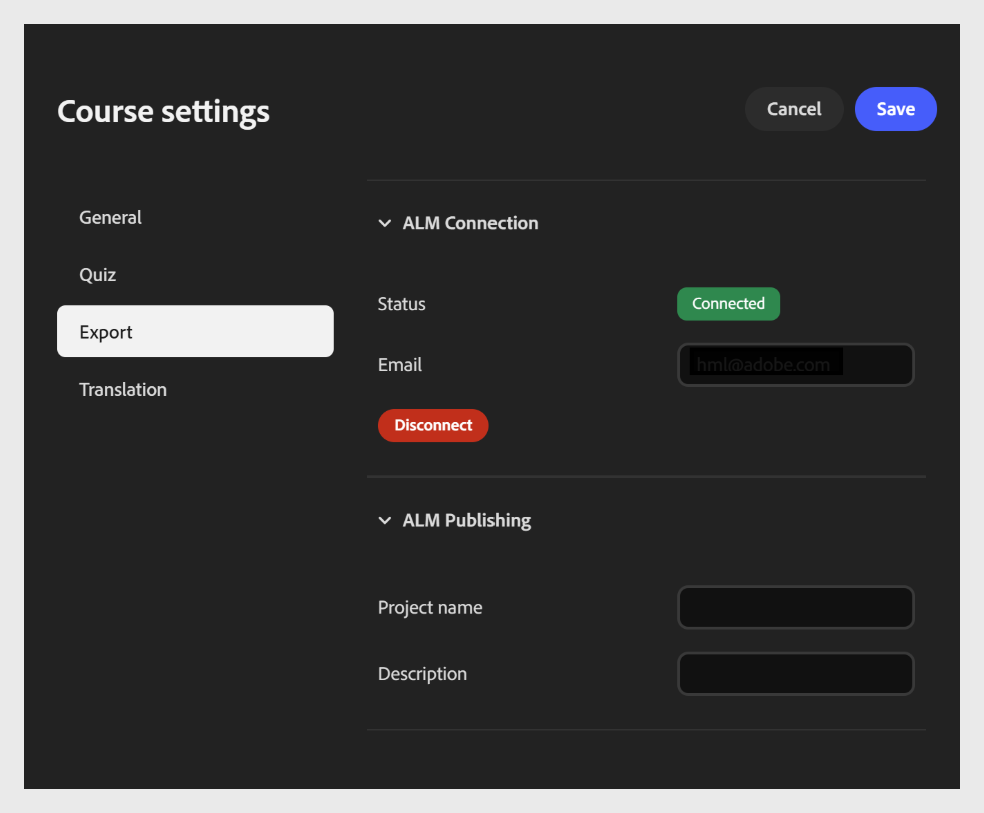
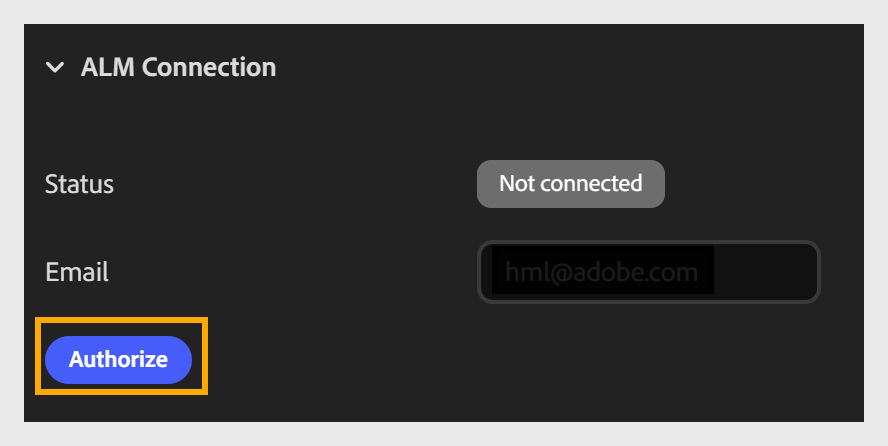
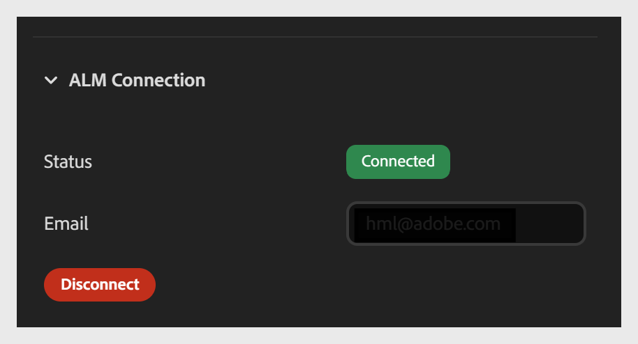

# Publish d’un cours du compositeur de contenu vers Adobe Learning Manager

L&#39;onglet **Exporter** vous permet de connecter votre cours à Adobe Learning Manager (ALM) et de le publier directement dans la bibliothèque de contenu ALM. Pour configurer la connexion, entrez votre adresse e-mail dans le champ **Adresse e-mail**. Assurez-vous que vous disposez d’un compte ALM avec le même ID de connexion à l’adresse électronique. Une fois connecté, vous pouvez publier le cours dans ALM en tant que module.

Cette connexion est une configuration unique par cours. Une fois établi, vous n’avez pas besoin de vous reconnecter chaque fois que vous publiez ou exportez.

Il comporte deux sections :

- Section Connexion ALM

- Section Publication ALM

**Pour configurer les paramètres d&#39;exportation**

1. Ouvrez les **paramètres du cours** et sélectionnez l&#39;onglet **Exporter** sur la gauche.

2. Développez la section **Connexion ALM** (si elle n&#39;est pas déjà développée).

   - Saisissez l&#39;adresse **e-mail** associée à votre compte Adobe Learning Manager.

   - Sélectionnez **Autoriser** pour vous connecter et connecter le cours à votre compte ALM.
     

   - Une fois autorisé, confirmez les mises à jour du champ **État** de **Déconnecter** à **Connecté**.
     

## Détails de la publication Adobe Learning Manager

Après avoir connecté votre compte, configurez les détails de publication dans la section Publication ALM.

- Saisissez un nom de **projet** pour identifier le cours. Ce nom apparaît comme le titre du cours dans la bibliothèque de contenu ALM.

- Saisissez une **description** : bref résumé du cours qui apparaît à côté dans la bibliothèque de contenu ALM, afin d&#39;aider les élèves et les administrateurs à comprendre son objectif.

- Sélectionnez **Publish** pour envoyer le cours à la bibliothèque de contenu ALM en tant que module.

## Navigation des élèves dans les cours publiés du compositeur de contenu

Découvrez comment les élèves parcourent les cours du compositeur de contenu publiés sur Adobe Learning Manager ou exportés sous forme de packages SCORM, y compris la table des matières réductible et la navigation mobile.

## Table des matières réductible

Les cours publiés sur Adobe Learning Manager ou exportés sous forme de packs SCORM incluent une leçon réductible et un panneau de navigation par rubrique.

Les élèves peuvent :

- **Développez** le panneau de navigation pour parcourir les leçons et les rubriques et accéder à n&#39;importe quelle section.
- **Réduisez** le panneau de navigation pour vous concentrer sur le contenu du cours sans que le panneau ne prenne d&#39;espace sur l&#39;écran.
L’état du panneau est conservé au fur et à mesure que les élèves suivent le cours.

## Navigation mobile

Sur les appareils mobiles, la navigation entre la leçon et la rubrique s’ouvre en tant qu’incrustation en plein écran plutôt que sous forme de panneau latéral. Les élèves sélectionnent l&#39;icône de navigation pour ouvrir l&#39;incrustation, recherchent la leçon ou la rubrique de leur choix et la sélectionnent pour y accéder.

L’incrustation se ferme automatiquement une fois que l’élève a sélectionné une destination, et les renvoie au contenu du cours.
