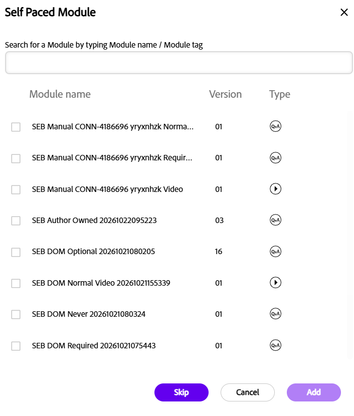

# Création d&#39;un cours avec l&#39;Explorateur d&#39;examens sécurisé

Les auteurs peuvent ajouter des quiz aux cours qui nécessitent un Explorateur d&#39;examens sécurisé pour fournir un environnement d&#39;évaluation sécurisé et restreint. Safe Exam Browser s&#39;applique uniquement aux quiz Adobe Learning Manager natifs individuels et ne restreint pas l&#39;accès aux autres modules du cours.

Avant d&#39;ajouter le quiz à un cours, assurez-vous que l&#39;Explorateur d&#39;examens sécurisé est activé pour le quiz. Si le cours comprend d&#39;autres types de livraison, tels que des modules de classe virtuelle, ces modules continuent de fonctionner indépendamment de l&#39;exigence de l&#39;Explorateur d&#39;examens sécurisé.

Cet article explique comment ajouter un quiz avec navigateur Safe Exam à un cours et configurer ses paramètres pour le cours.

## Création d’un quiz en mode Explorateur d’examens sécurisé

Le mode Explorateur d&#39;examens sans échec détermine si les élèves doivent utiliser l&#39;Explorateur d&#39;examens sans échec pour répondre au quiz. L’option s’affiche uniquement après qu’un administrateur a activé l’intégration de l’Explorateur d’examens sécurisé pour le compte. Afficher **Activer le navigateur Safe Exam** pour plus d&#39;informations.

Pour créer un quiz en mode Explorateur d&#39;examens sans échec :

1. Connectez-vous à ALM en tant qu’auteur.
1. Sélectionnez **Créer du contenu**.

   La page **Bibliothèque de contenu** s&#39;affiche.

1. Sélectionnez **Ajouter** > **Quiz**.

   La page **Créer un quiz** s&#39;ouvre.

1. Saisissez un nom pour le quiz dans le champ **Nom**.
1. (Facultatif) Saisissez une description pour le quiz dans le champ Description.
1. Sélectionnez **Ajouter une question de quiz** et ajoutez **Critères de réussite**.
1. Activez le **mode Explorateur d&#39;examens sans échec**. L&#39;option **Autoriser l&#39;auteur à effectuer une personnalisation lors de la création du cours** apparaît.

   

1. (Facultatif) Activez **Autoriser l&#39;auteur à effectuer une personnalisation lors de la création du cours**.

   L&#39;option Explorateur d&#39;examens sans échec apparaît lorsque vous configurez le code du cours.

   >[!NOTE]
   >
   > Si l&#39;administrateur active cette option, vous pouvez activer ou désactiver la configuration requise de l&#39;Explorateur d&#39;examens sécurisé (SEB) pour un module de quiz de cours. Si l’administrateur désactive cette option, SEB devient obligatoire pour le quiz et vous ne pouvez pas modifier cette exigence. Voir [Activer l&#39;intégration du navigateur Safe Exam Browser](../../administrators/feature-summary/safe-exam-browser.md#enable-safe-exam-browser-integration) pour plus d&#39;informations.

1. Sélectionnez **Publish**.

## Ajouter un quiz avec navigateur d&#39;examen sécurisé à un cours

Ajoutez le quiz en tant que module d&#39;auto-apprentissage pour demander l&#39;Explorateur d&#39;examens sécurisé pour cette évaluation. Avant de commencer, assurez-vous que le quiz est publié avec l’Explorateur d’examens sécurisé activé. Voir Activer un Explorateur d’examens sécurisé pour plus d’informations.

Pour ajouter le quiz à un cours :

1. Sélectionnez **Créer un cours** et saisissez le nom et la description du cours.
1. Sélectionnez **Ajouter des modules** dans la page **Modules**.

   La fenêtre contextuelle Modules s’affiche.

1. Sélectionnez **Apprentissage individualisé**. La boîte de dialogue **Module individualisé** s&#39;ouvre.

   

1. Cochez la case en regard du quiz Navigateur d’examen sécurisé que vous avez créé.
1. Sélectionnez **Ajouter**. Le quiz est ajouté au cours en tant que module d&#39;auto-apprentissage.
1. (Facultatif) Pour ajouter un autre type de livraison au cours, sélectionnez **Ajouter d&#39;autres types de livraison** et configurez le module requis.
1. Sélectionnez **Enregistrer** > **Publish**.

   Le cours inclut désormais une évaluation qui exige que les élèves utilisent l’Explorateur d’examens sécurisé.

Consultez [Lancer un quiz dans l&#39;Explorateur d&#39;examens sécurisé](../../learners/feature-summary/launch-safe-exam-browser.md) pour savoir comment les élèves peuvent accéder et répondre aux quiz à l&#39;aide de l&#39;Explorateur d&#39;examens sécurisé.
