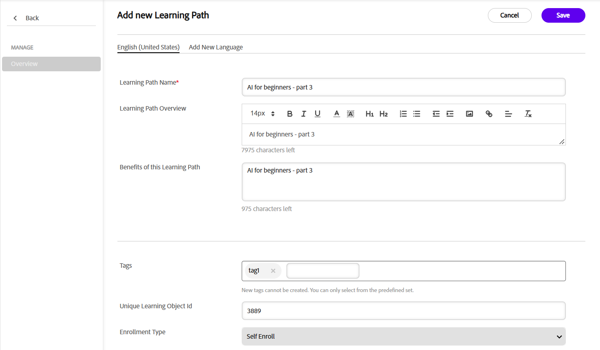

# Création d’un parcours d’apprentissage

Un auteur peut créer un parcours d’apprentissage que les élèves peuvent suivre. Pour créer un parcours d’apprentissage dans l’application d’auteur :

1. Connectez-vous en tant qu&#39;**auteur**.
1. Sélectionnez **Apprentissage** > **Parcours d’apprentissage**.
1. Sélectionnez **Ajouter**.

   

1. **Nom du parcours d’apprentissage** : saisissez un nom pour le parcours d’apprentissage.
1. **Présentation du parcours d’apprentissage** : entrez une brève présentation du parcours d’apprentissage.
1. **Avantages de ce parcours d’apprentissage** : décrivez quelques avantages du parcours d’apprentissage.
1. **Balises** : sélectionnez les balises appropriées dans la liste prédéfinie.
1. **ID d&#39;objet d&#39;apprentissage unique** : entrez un ID unique pour l&#39;objet d&#39;apprentissage.
1. **Type d&#39;inscription** : sélectionnez le type d&#39;inscription dans le menu déroulant.
1. **Formule tarifaire** : sélectionnez **Payant** ou **Gratuit**. Si vous sélectionnez **Gratuit**, la case **Prix du parcours d’apprentissage** est désactivée.
1. **Désinscription** : sélectionnez cette option pour permettre aux élèves de se désinscrire.
1. **Image de couverture** : sélectionnez une image de couverture pour le parcours d’apprentissage.
1. **Image de bannière** : sélectionnez une image de bannière pour le parcours d’apprentissage.
1. **Sélectionner des catalogues** : sélectionnez les catalogues pertinents dans la liste.
1. **Étiquette de conformité** : sélectionnez l&#39;étiquette de conformité appropriée dans la liste.
1. **Libellés** : sélectionnez le libellé approprié dans la liste.
1. **ID de badge Credly** : sélectionnez l&#39;étiquette appropriée dans la liste.
1. **Niveau de difficulté** : sélectionnez le niveau de difficulté approprié dans la liste.
1. **Conformité** : sélectionnez le niveau de conformité approprié dans la liste.

   >[!NOTE]
   >
   > À tout moment avant d&#39;enregistrer, vous pouvez ajouter une nouvelle langue en sélectionnant l&#39;onglet **Ajouter une nouvelle langue**, en sélectionnant une langue dans la liste, puis en sélectionnant **Enregistrer**. L&#39;anglais est la langue par défaut.

   

1. Sélectionnez **Enregistrer**. Une nouvelle page avec le nom du parcours d’apprentissage s’affiche. Vous pouvez désormais ajouter des compétences et des produits, organiser des sections et ajouter des cours ou des parcours d’apprentissage.

   

1. Sélectionnez **Compétences que les élèves acquerront**. Dans la section qui s’ouvre, sélectionnez les compétences que vous souhaitez que les élèves acquièrent et leurs niveaux.

   

1. Sélectionnez **Ajouter**.
1. Sélectionnez la façon dont vous souhaitez organiser les sections et les cours ou les parcours d’apprentissage. Sélectionnez **Trié** ou **Non trié**.
1. Ensuite, sélectionnez **Ajouter des cours ou des parcours d’apprentissage**. Une fenêtre contenant des cours et des parcours d’apprentissage existants s’affiche. Chaque vignette indique le nom, le type (cours ou parcours d’apprentissage), l’état de la publication et le format du cours. S&#39;il s&#39;agit d&#39;un cours, il affiche le type auto-apprentissage, virtuel, salle de classe ou fusionné. S’il s’agit d’un parcours d’apprentissage, le nombre de cours s’affiche.

   

1. Sélectionnez les cours ou parcours d’apprentissage que vous souhaitez ajouter au parcours d’apprentissage.

   

1. Sélectionnez **Ajouter**. Les cours et parcours d’apprentissage apparaissent sur la page du parcours d’apprentissage.

   

1. Sélectionnez **Compétences que les élèves acquerront**. Sélectionnez les compétences et les niveaux. Sélectionnez **Ajouter**.
1. Mappez le parcours d’apprentissage aux produits en sélectionnant des produits dans la liste, puis en sélectionnant leurs niveaux.

   >[!NOTE]
   >
   > Si vous ne sélectionnez pas au moins un produit, vous ne pourrez pas publier le parcours d’apprentissage.

   

1. Sélectionnez la façon dont vous souhaitez organiser les sections et les cours ou les parcours d’apprentissage. Sélectionnez **Trié** ou **Non trié**.
1. Sélectionnez **Ajouter un titre de section**, puis saisissez un titre de section.

   

1. Sélectionnez **Envoyer**.
1. Sélectionnez **Obligatoire** pour rendre le parcours d’apprentissage obligatoire. Si vous ne le sélectionnez pas, le parcours d’apprentissage devient facultatif.
1. Si vous souhaitez ajouter une autre section avec un parcours d’apprentissage différent, répétez les étapes 24 à 30.
1. **Conditions d’achèvement** : sélectionnez **Toutes** ou un numéro dans la liste pour terminer la formation.
1. Déplacez les cours vers le haut ou vers le bas pour modifier leur ordre.
1. Pour supprimer un cours du parcours d’apprentissage, sélectionnez **X** sur la carte de cours.
1. Sélectionnez **Publish**. Pour afficher le parcours d’apprentissage nouvellement publié, revenez à la page **Parcours d’apprentissage**.
