# Gestion des élèves pour votre session

Lisez cet article pour savoir comment gérer les participants et envoyer des courriers électroniques concernant un cours et des rappels pour vos sessions.

## Voir les sessions ou modules avec des révisions en cours {#pending}

En tant qu’instructeur, vous pouvez voir les sessions ou modules avec des révisions en cours.

La page Sessions/Modules affiche une colonne **Révisions en attente** qui indique le nombre de révisions en attente pour la session/l&#39;activité correspondante.

## Gérer la liste d’attente pour votre session {#managewaitlistforyoursession}

Lorsque les élèves s’inscrivent à votre module, vous pouvez voir l’état le plus récent des inscriptions et de la liste d’attente sur la page Liste d’attente.

1. Dans l’application Instructeur, sélectionnez Sessions à venir > Liste d’attente dans le volet de navigation de gauche.

   Vous pouvez voir la limite de places, ainsi que le nombre de places actuellement remplies ou vides. Un tableau indique également les élèves qui se trouvent dans la liste d’attente. Il est vide s’il n’existe pas de file d’attente.

   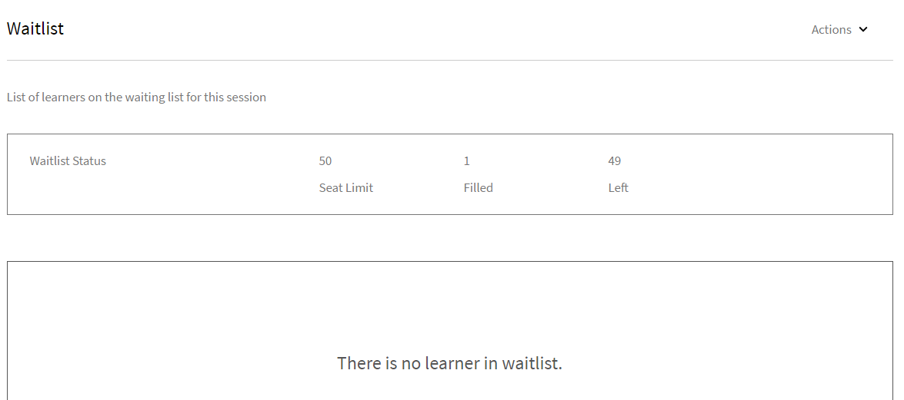
   *Afficher les élèves inscrits sur liste d’attente*

1. Dans le tableau Liste d’attente, sélectionnez le ou les élèves que vous souhaitez confirmer.
1. Sélectionnez Actions > Confirmer les élèves.

   Les élèves que vous avez confirmés sont ajoutés à la liste des élèves confirmés.

Les instructeurs peuvent désinscrire les élèves des sessions. Ces derniers sont alors désinscrits des apprentissages correspondants. Sélectionnez l’onglet **[!UICONTROL Liste d’attente]**. Cochez la case des élèves à désinscrire. Pour vous désinscrire, sélectionnez **[!UICONTROL Actions]** > **[!UICONTROL Désinscrire des élèves]**.

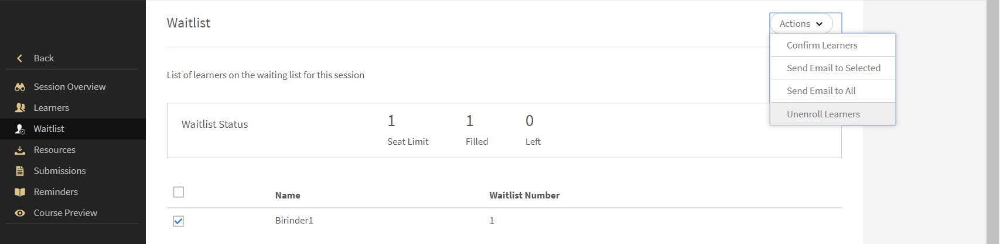
*Désinscrire les élèves*

### Rapport de liste d’attente

Le nouveau **[!UICONTROL rapport sur la liste d&#39;attente]** de Adobe Learning Manager permet aux instructeurs de télécharger la liste d&#39;élèves sur liste d&#39;attente pour toutes les instances d&#39;un cours. Les instructeurs peuvent accéder à ce rapport à partir de la section **[!UICONTROL Liste d&#39;attente]** sur la page **[!UICONTROL Présentation de la session]**.

En suivant les colonnes disponibles dans le rapport Liste d’attente :

* Nom du cours
* Nom de l’instance
* ID d’instance
* État d’instance
* Nom d’utilisateur
* Courrier électronique
* ID utilisateur unique
* Date d’inscription (fuseau horaire UTC)
* Statut
* Nombre de listes d’attente
* Limite de liste d’attente
* Limite de postes

Pour télécharger le rapport à partir de la section Instructeur :

1. Connectez-vous en tant que **[!UICONTROL instructeur]**.
2. Sélectionnez une session dans la page d’accueil.
3. Sélectionnez l&#39;option **[!UICONTROL Liste d&#39;attente]** dans la page **[!UICONTROL Présentation de la session]**.
4. Sélectionnez **[!UICONTROL Actions]** > **[!UICONTROL Exporter le rapport]** pour télécharger le rapport **[!UICONTROL Liste d&#39;attente]**.

## Noter l’assiduité pour votre session {#markattendanceforyoursession}

Vous pouvez voir le nombre d’élèves confirmés qui assistent à la session, leur nom, leur assiduité et d’autres informations sur la page Élèves.

1. Dans le volet de navigation de gauche, cliquez sur Sessions à venir > Élèves.
1. Sélectionnez le ou les élève(s) dans la liste des participants et effectuez l’une des opérations suivantes :

   * Pour noter l’assiduité, cliquez sur Actions > Noter l’assiduité. Une fois l’état défini sur A participé, vous ne pouvez plus le modifier.
   * Pour noter l’absence, cliquez sur Actions > N’a pas participé.
   * Pour supprimer un élève en raison d’une annulation ou pour d’autres raisons, cliquez sur Actions > Supprimer des élèves.

   Un élève ne peut pas terminer un module tant que son assiduité n’est pas marquée comme A participé.

   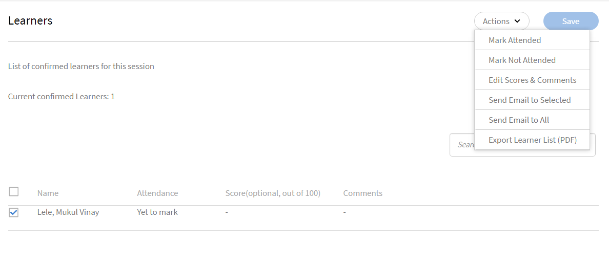
   *Marquer l’élève comme participant*

### Télécharger les codes QR pour l&#39;inscription et la présence des élèves

Les instructeurs peuvent télécharger des codes QR pour les sessions qui leur sont attribuées pour permettre aux élèves de s&#39;inscrire à une instance de cours et de marquer l&#39;assiduité ou l&#39;achèvement en scannant le code QR.

Cela permet aux instructeurs de gérer la participation à la session de manière indépendante, sans avoir besoin de l’aide de l’administrateur.

Les étapes suivantes conviennent pour les deux :

* Sessions de classe physique
* Sessions de classe en ligne

Pour une session de classe physique, en tant qu’instructeur, vous devez générer le code QR approprié et le coller dans la salle de classe (ou le faire circuler) où les élèves assistent à la session afin qu’ils puissent numériser le code QR et marquer leur inscription ou leur présence ou les deux selon le code QR.

Pour une session de classe en ligne, en tant qu&#39;instructeur, vous pouvez envoyer le code QR généré par courrier, par un système de messagerie ou par tout autre moyen afin que les élèves puissent numériser le code QR et marquer leur inscription ou leur présence ou les deux selon le code QR.

#### Télécharger les codes QR d’une session

1. Connectez-vous à Adobe Learning Manager avec le rôle **Instructeur**.
2. Accédez au tableau de bord **Instructeur**.
3. Ouvrez l&#39;**instance de cours** concernée.
4. Sélectionnez l&#39;onglet **Sessions**.
5. Choisissez une session qui vous est attribuée.
6. Sélectionnez **Code QR de session**.
   

Vous pouvez télécharger les codes QR suivants :

* **Code QR d&#39;inscription** : permet aux élèves de s&#39;inscrire à l&#39;instance de cours
* **Code QR de présence** : marque la présence pour la session
* **Code QR d&#39;inscription + de présence** : inscrit des élèves et marque la présence dans une seule numérisation

Le code QR est téléchargé en tant que PDF et peut être partagé numériquement ou affiché pendant la session.

#### Que se passe-t-il lorsque les élèves scannent le code QR ?

* Les élèves scannent le code QR à l&#39;aide d&#39;un appareil mobile.
* Adobe Learning Manager valide l’élève et la session.
* En fonction du type de code QR :
  * Les élèves sont inscrits à l’instance de cours, ou
  * La présence et l&#39;achèvement sont enregistrés pour la session

Toutes les mises à jour sont automatiquement répercutées dans les dossiers, les relevés de notes et les rapports des élèves.

#### Annotations

* Les codes QR sont disponibles uniquement pour les instructeurs affectés à la session.
* Les règles d’inscription, de présence et d’achèvement configurées pour le cours et la session continuent de s’appliquer.
* Les workflows existants de progression des élèves et de génération de rapports restent inchangés.

#### Cas d’utilisation

* Les organisations qui exécutent de gros volumes de sessions sur site (par exemple, une formation produit pour les professionnels) peuvent permettre aux instructeurs d’imprimer des codes QR spécifiques à la session qui s’inscrivent et marquent la présence à l’aide d’une seule numérisation.

* Dans les formations sur la vente au détail, la fabrication et les soins de santé, où les élèves rejoignent souvent les sessions directement à partir de l&#39;étage ou sans pré-inscription, un code QR « Inscription + Présence » peut être placé à la porte. Cela permet aux élèves d&#39;accéder en libre-service à leur inscription et à leur assiduité via leurs téléphones.

* Les événements de formation pour les partenaires ou les clients permettent au formateur sur site de s&#39;adapter facilement aux changements de salle, aux sessions supplémentaires ou aux participants supplémentaires sans avoir à consulter l&#39;administrateur pour de nouveaux codes QR.

### Invitations au calendrier {#calendarinvites}

* Lorsqu’un élève ou un instructeur est inscrit à une session de classe ou de classe virtuelle, Learning Manager envoie une invitation de calendrier (fichier ICS).
* L’invitation au calendrier comprend :

  * Date et heure de la session
  * Détails de la session
  * **Lien de participation directe à la session** dans la description du calendrier

  

Les participants peuvent ouvrir l’événement de calendrier et participer à la session directement à partir de leur calendrier.

#### Rejoindre une session à partir de Gmail

1. Ouvrez le **Calendrier Google**.
2. Sélectionnez l’événement de session.
3. Dans les détails de l&#39;événement, cliquez sur le lien **participation à la session**.
4. La session s’ouvre directement dans Adobe Learning Manager ou dans l’outil de classe virtuelle configuré.

Vous n’avez pas besoin d’ouvrir l’e-mail d’origine pour accéder au lien de la session.

#### Participation à une session à partir d’autres clients de calendrier

Le lien de session est inclus dans le corps de l’événement de calendrier et est accessible à partir de :

* Microsoft Outlook
* Calendrier Apple
* Autres applications de calendrier prenant en charge les fichiers ICS

#### Annotations

* Les invitations au calendrier sont générées automatiquement par Learning Manager.
* Les informations de fuseau horaire dans l’invitation du calendrier s’ajustent en fonction du fuseau horaire sélectionné de l’élève.
* Cette amélioration s’applique aux invitations de calendrier nouvellement générées.
* Aucune configuration supplémentaire n’est requise par les administrateurs ou les instructeurs.

## Marquer le succès pour les élèves

Les instructeurs peuvent marquer le statut de réussite de chaque élève comme Réussite ou Échec directement à partir de la page Élèves. Cette fonctionnalité permet aux instructeurs d’enregistrer avec précision les résultats des sessions de salle de classe ou de classe virtuelle en fonction des performances de l’élève.

Pour marquer le succès pour les élèves :

1. Connectez-vous à Adobe Learning Manager en tant qu’instructeur.
2. Sélectionnez **[!UICONTROL Sessions à venir]** dans le volet de navigation de gauche.
3. Sélectionnez **[!UICONTROL Élèves]**.
4. Sélectionnez les élèves, puis **[!UICONTROL Actions]**.
5. Sélectionnez l’une des options suivantes pour indiquer la réussite des élèves sélectionnés :

   * **[!UICONTROL Marquer comme Terminé et Réussite]** : les élèves marqués comme Réussis ont terminé le module.
   * **[!UICONTROL Marquer comme terminé et échec]** : les élèves marqués comme ayant échoué ont terminé le module mais n&#39;ont pas réussi.

   
   _Page Élèves affichant le menu Actions avec les options Marquer comme Terminé et Réussite et Marquer comme Terminé et Échec mises en évidence pour enregistrer les résultats de l&#39;élève_

6. Sélectionnez **[!UICONTROL Oui]** dans l&#39;invite de confirmation.

## Envoyer des courriers électroniques à des élèves {#sendemailstolearners}

Vous pouvez envoyer des courriers électroniques à une partie ou à l’ensemble des participants à la session. La fonction Envoyer un courrier électronique est très utile si vous souhaitez confirmer l’assiduité des élèves ou faire part d’informations concernant la session. Vous pouvez également utiliser la fonction Envoyer un courrier électronique à tous afin d’envoyer des documents pour les devoirs et la session ou des informations d’ordre général à tous les élèves.

Pour envoyer des courriers électroniques aux élèves, effectuez l’une des opérations suivantes sur la page Élèves dans l’application Instructeur :

* Pour envoyer des courriers électroniques à certains participants, sélectionnez-les et cliquez sur Actions > Envoyer un courrier électronique à la sélection.
* Pour envoyer des courriers électroniques à tous les participants afin de leur transmettre des documents de cours ou des devoirs, cliquez sur Actions > Envoyer un courrier électronique à tous.

## Capturer les réponses à l’invitation

Les instructeurs peuvent capturer les réponses aux invitations des élèves uniquement lorsque l&#39;option **[!UICONTROL Inviter à répondre]** est activée par l&#39;administrateur ACAP. Pour activer cette fonctionnalité, les administrateurs doivent contacter l&#39;équipe d&#39;assistance à l&#39;adresse [learningmanagersupport@adobe.com](mailto:learningmanagersupport@adobe.com).

Une fois cela fait, vous pouvez afficher les réponses aux invitations dans la section **[!UICONTROL Élèves]**. Accédez à n’importe quelle session, sélectionnez **[!UICONTROL Élèves]**, puis sélectionnez la réponse à l’invitation dans le menu déroulant.

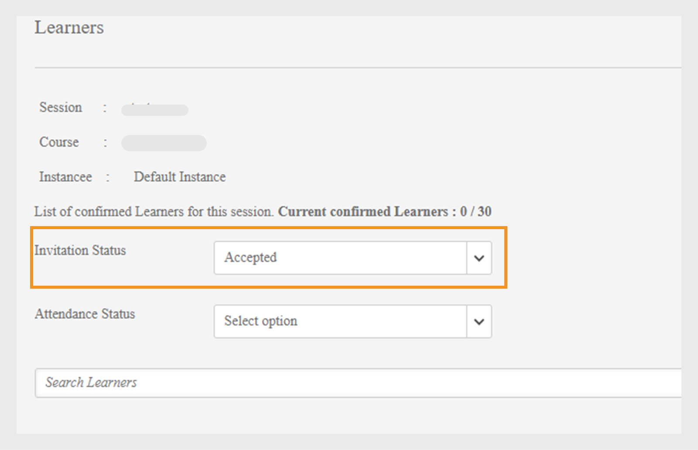

## Exporter la liste des élèves {#exportinglearnerslist}

En tant que formateur, vous pouvez facilement indiquer l’assiduité de l’ensemble de vos élèves en exportant la liste des participants au format PDF. Pour exporter la liste des participants, dans le panneau de gauche de l’application Élève, cliquez sur Actions > Exporter la liste des élèves (PDF).

Une fois que la liste des participants est confirmée pour votre session, vous pouvez exporter la liste au format PDF. Ce fichier PDF facile à imprimer affiche les élèves dans un tableau. Vous pouvez ensuite indiquer l’assiduité ou les scores, et créer ou fournir des remarques à l’élève, le tout dans le même fichier PDF.

Notez le code QR dans le coin supérieur droit de ce fichier PDF. Cette fonctionnalité permet à chaque élève de numériser le code à l’aide de l’application mobile Learning Management pour qu’il indique sa participation.

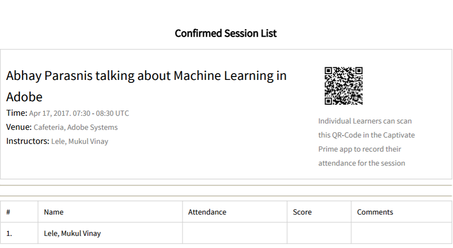
*Scannez le code QR pour marquer l&#39;assiduité*

## Approuver ou refuser des envois {#approveorrejectsubmissions}

Si les élèves ont téléchargé des documents tels que des devoirs, des rapports ou des évaluations pour votre session, vous pouvez les voir sur la page Envois. Vous pouvez utiliser les documents pour évaluer l’élève et approuver ou rejeter l’envoi.

1. Dans le volet de gauche, cliquez sur Sessions à venir ou Sessions précédentes en fonction de la planification de votre session.
1. Cliquez sur le cours pour lequel vous souhaitez visualiser les envois.

   Dans le volet de gauche, cliquez sur Envois.

1. Vous pouvez afficher les envois des élèves pour la session que vous avez sélectionnée. Sélectionnez l’envoi à approuver ou rejeter, puis cliquez sur Approuver ou Rejeter.

   L’état de l’envoi devient Approuvé ou Rejeté en fonction de votre action.

## Configurer des rappels pour votre session {#configureremindersforyoursession}

1. Dans le volet de gauche, cliquez sur Sessions à venir.
1. Cliquez sur le cours pour lequel vous souhaitez définir le rappel. Dans le volet de gauche, cliquez sur Rappels.
1. Dans la vignette Sélectionner un rappel, cliquez sur Programmer un rappel.

   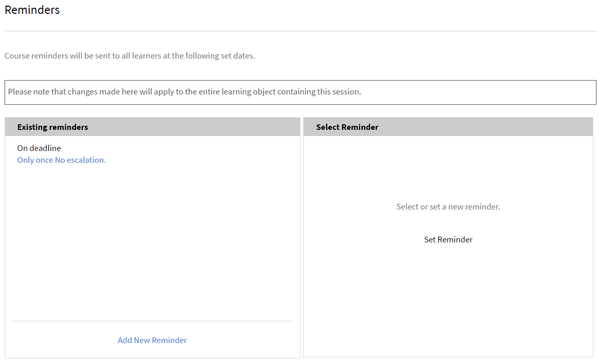
   *Configurer des rappels pour votre session*

1. Procédez comme suit :

   * Dans la boîte de dialogue Paramètres de rappel, définissez l’option sur le moment auquel le rappel doit être envoyé aux élèves : Avant l’échéance, À échéance ou Après l’échéance.
   * Dans le champ Nombre de jours précédant l’échéance, définissez le nombre de jours précédant l’échéance auquel vous souhaitez envoyer le rappel aux élèves.
   * Définissez la périodicité de votre rappel.

   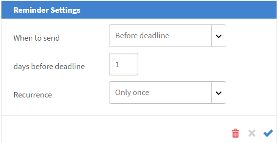
   *Afficher les paramètres de rappel*

1. Effectuez l’une des opérations suivantes :

   * Cliquez sur la coche pour enregistrer le rappel.
   * Cliquez sur la croix pour annuler le rappel.

   Un rappel de cours automatique est envoyé à tous les élèves à la date que vous avez programmée dans vos paramètres de rappel.

   Si vous avez déjà défini des rappels pour vos sessions, vous pouvez les voir sous les vignettes Rappel existant. De plus, vous pouvez également ajouter de nouveaux rappels à vos rappels existants.

   Pour supprimer un rappel existant, cliquez dessus. Dans la fenêtre contextuelle qui s’affiche, cliquez sur l’icône de suppression (corbeille) pour supprimer le rappel.

## Création et gestion d’équipes dans Adobe Learning Manager

Créez manuellement des équipes à partir des élèves d&#39;une instance de cours, puis ajoutez, déplacez, supprimez, renommez ou supprimez des équipes jusqu&#39;à ce qu&#39;une équipe se verrouille.

En tant qu’instructeur, vous créez des équipes pour chaque instance d’un cours qui dispose d’un module d’envoi basé sur les équipes. Tout instructeur affecté à l’instance peut gérer ses équipes. Adobe Learning Manager peut également créer des équipes automatiquement. Une fois les équipes formées, les élèves peuvent soumettre leur travail et vous pouvez évaluer les soumissions d&#39;équipe.

### Ouvrir la page de gestion des équipes

1. Dans l&#39;application Instructeur, sélectionnez **Équipes** dans le volet de navigation de gauche. La page répertorie les instances de cours en équipe auxquelles les élèves sont affectés.

   Option 

1. Pour trouver un cours, recherchez-le ou triez la liste par date de dernière mise à jour.

1. Sélectionnez l&#39;instance de cours. La page de l’instance affiche les élèves non affectés et les équipes.

### Création d’équipes avec une règle

1. Sur la page de l’instance, sélectionnez les élèves non affectés à diviser en équipes.

1. Choisissez une règle. Sélectionnez **Action** > **Former une seule équipe** ou **Former plusieurs équipes**.

   

1. Si vous sélectionnez **Former plusieurs équipes**, entrez le nombre d&#39;élèves par équipe. La valeur doit être supérieure ou égale à 1. La page indique le nombre d’équipes qui seront créées. Par exemple, avec 94 élèves et 2 élèves par équipe, 47 équipes sont créées. Si le nombre est supérieur au nombre d’élèves inscrits, un message d’erreur s’affiche. Entrez un nombre plus petit.

   

   Si vous entrez une valeur supérieure au nombre d&#39;élèves inscrits, un message d&#39;erreur s&#39;affiche.

   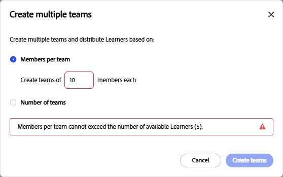

1. Sélectionnez **Créer des équipes**. Les équipes apparaissent dans l&#39;onglet **Équipes**.

   

1. Confirmez, puis enregistrez. Les équipes apparaissent dans l&#39;onglet **Équipes**.

La règle s’applique uniquement aux élèves non affectés que vous sélectionnez. Pour regrouper tout le monde, supprimez d’abord les équipes existantes. Leurs élèves retournent à la liste non attribuée.

Option 

Après avoir sélectionné **Supprimer**, vous obtenez la boîte de dialogue de confirmation suivante :

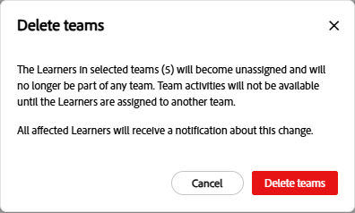

Sélectionnez **Supprimer les équipes**. Tous les élèves reviennent à la liste non attribuée.

### Créer une seule équipe

1. Sélectionnez les élèves non affectés à inclure dans l’équipe.

1. Sélectionnez **Action** > **Former une seule équipe**. Une équipe est créée avec le nombre spécifié d’élèves.

   

1. Sauvegardez l’équipe. Une équipe a besoin d’au moins un élève, et un élève ne peut appartenir qu’à une seule équipe dans l’instance.

1. Répétez les étapes pour créer des équipes une par une.

### Ajouter des élèves à une équipe existante

1. Sélectionnez les élèves non affectés à ajouter.

1. Choisissez de les affecter à une équipe existante, puis sélectionnez l’équipe.

   

1. Confirmez votre choix. Sélectionnez **Attribuer un élève**.

### Déplacement ou suppression d’élèves

1. Ouvrez l&#39;onglet **Équipes**, puis développez une équipe pour afficher ses membres.

1. Sélectionnez les élèves à déplacer.

   

1. Choisissez de les déplacer, puis sélectionnez l’équipe de destination.

1. Pour supprimer un élève d’une équipe, sélectionnez-le et supprimez-le. L’élève revient à la liste des éléments non attribués.

Lorsqu’une équipe ne compte plus d’élèves, elle est automatiquement supprimée.

### Renommer une équipe

1. Dans l&#39;onglet **Équipes**, sélectionnez l&#39;équipe, puis choisissez de la renommer.

1. Sélectionnez **Action** > **Renommer**.

   

1. Saisissez un nom unique, tel que Alpha de l’équipe.

   

1. Sélectionnez **Renommer l&#39;équipe**.

Les noms ne peuvent pas être répétés et vous ne pouvez pas utiliser le format généré par le système, tel que Team-1.

### Supprimer les équipes

1. Dans l&#39;onglet **Équipes**, sélectionnez une ou plusieurs équipes.

1. Sélectionnez **Action** > **Supprimer**.

1. Sélectionnez **Supprimer l&#39;équipe**.

   

1. Confirmer. Les élèves des équipes supprimées reviennent dans la liste des élèves non attribués.

### Gérer les inscriptions et les désinscriptions en retard

* Un élève qui s’inscrit après la création d’équipes apparaît dans la liste Non affecté. Ajouter l’élève à une équipe.
* Si toutes les équipes sont verrouillées, créez une nouvelle équipe pour l’élève.
* Un élève qui se désinscrit est automatiquement supprimé de son équipe. L’équipe continue et une équipe vide est supprimée.

### Dépannage

**Vous ne pouvez pas sélectionner une équipe ni déplacer ses membres.** Un verrou d&#39;équipe se verrouille après sa première soumission et s&#39;applique à chaque module d&#39;équipe de l&#39;instance. Pour déverrouiller l’équipe, annulez l’envoi. Afficher **Évaluer et annuler l&#39;envoi des soumissions d&#39;équipe**.

**Vous ne pouvez pas renommer une équipe.** Le nom est déjà utilisé ou correspond au format généré par le système. Entrez un autre nom.

**Une erreur s’affiche lorsque vous créez des équipes.** Une équipe ne peut pas compter plus de 100 membres. Réduisez le nombre de membres par équipe.

**Vous ne pouvez pas ouvrir la gestion des équipes pour une instance.** La création automatique d’équipe est peut-être en cours d’exécution. Access revient une fois l&#39;opération terminée.

**Votre enregistrement est rejeté et la page se recharge.** Un autre instructeur ou la tâche automatique a d’abord enregistré les modifications. Passez en revue les équipes mises à jour, puis rétablissez votre modification.

**Une équipe a disparu.** Une équipe sans élèves est automatiquement supprimée.

## Évaluer et annuler l’envoi des soumissions d’équipe

Passez en revue le fichier soumis par une équipe, terminez le plan d&#39;évaluation, approuvez ou rejetez le travail, ou annulez sa soumission afin que l&#39;équipe puisse le soumettre à nouveau.

Lorsque vous évaluez une soumission d&#39;équipe, le résultat s&#39;applique à chaque membre de l&#39;équipe, et chaque membre reçoit une notification. Seuls les instructeurs affectés à l’instance peuvent évaluer. Les étapes sont les mêmes pour les soumissions individuelles, excepté que les soumissions individuelles n’ont pas de détails d’équipe. Assurez-vous d’abord que les équipes existent. Voir **Créer et gérer des équipes**.

Les équipes créées automatiquement peuvent être modifiées de la même manière que les équipes manuelles.

### Rechercher une soumission

1. Dans l&#39;application Instructeur, ouvrez la zone d&#39;envois, puis sélectionnez **Envois d&#39;équipe**. Sélectionnez **Envois individuels** pour les modules mono-élèves.

1. Pour rechercher un module, effectuez une recherche par nom de session ou de module.

1. Sélectionnez le nom du module.

   

1. Pour affiner la liste, filtrez par statut : **Envoi en attente**, **Révision en attente**, **Approuvé**, **Rejeté** ou **Terminé**.

1. Pour afficher les membres de l’équipe, développez l’équipe. Les noms et les adresses e-mail s&#39;affichent et l&#39;élève qui a envoyé le fichier a une balise **Émetteur**.

1. Pour télécharger le fichier envoyé, sélectionnez l’option de téléchargement pour l’équipe.

### Évaluer une soumission

1. Recherchez l&#39;équipe avec le statut **Révision en attente**.

1. Ouvrez le fichier envoyé et examinez le contenu.

1. Sélectionnez **Action** > **Évaluer**.

   

1. Terminer le plan d&#39;évaluation :

   * Répondez à toutes les questions requises.
   * Pour les questions objectives, sélectionnez une option. Avec la notation basée sur des critères, le score est mis à jour au fur et à mesure de votre sélection.
   * Pour les questions subjectives, entrez votre réponse.
   * Lorsque des remarques sont autorisées, ajouter des remarques à la question ou à l&#39;ensemble de l&#39;évaluation.

   

1. Si le module nécessite l&#39;approbation du réviseur, sélectionnez **Approuver** ou **Rejeter**. Ajoutez un commentaire lorsque vous le rejetez, afin que l’équipe sache quoi corriger.

   

1. Si le module utilise l&#39;évaluation manuelle, entrez l&#39;évaluation globale.

   

   **Facultatif** : entrez une note privée en sélectionnant l&#39;option **Ajouter une note privée au score**. Une note privée n&#39;est visible que par les instructeurs affectés à l&#39;instance. Les élèves ne peuvent pas l&#39;afficher, même lorsque vous sélectionnez **Afficher le commentaire**.

1. Soumettez l’évaluation. Sélectionnez **Envoyer**. L&#39;état de l&#39;envoi passe à **Approuvé**.

   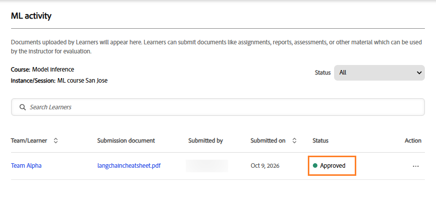

D’autres instructeurs peuvent également évaluer la même soumission, à condition qu’elle n’ait pas déjà été approuvée. Une évaluation ultérieure remplace une évaluation antérieure jusqu&#39;à ce que la soumission soit approuvée.

Si le module ne nécessite pas l&#39;approbation du réviseur, il est complété pour tous les membres de l&#39;équipe lors de la soumission de celle-ci. Seule l’option d’envoi s’affiche et vous ne pouvez pas modifier le score ou les remarques par la suite.

Après avoir approuvé ou rejeté la soumission d&#39;une équipe, un élève peut afficher l&#39;état de la soumission et le résultat de l&#39;évaluation.

La sélection du résultat d&#39;évaluation affiche les paramètres d&#39;évaluation et les commentaires de l&#39;instructeur.

## Réviser ou modifier une évaluation

1. Recherchez une équipe avec le statut **Refusé**.

1. Pour ouvrir l&#39;évaluation terminée, sélectionnez **Afficher l&#39;évaluation**.

1. Pour effectuer une nouvelle évaluation, sélectionnez l’option Réévaluer et soumettez vos modifications. Vous ne pouvez le faire que pour les envois rejetés. **Impossible de modifier les envois approuvés**.

### Annuler l’envoi d’une soumission

Annulez l&#39;envoi d&#39;une soumission lorsque l&#39;équipe doit à nouveau l&#39;envoyer, lorsque l&#39;évaluation doit recommencer ou lorsque vous devez modifier une équipe verrouillée. Pour une soumission individuelle, vous pouvez également l&#39;utiliser pour corriger une évaluation entrée pour le mauvais élève.

1. Recherchez une équipe ou un élève disposant d&#39;une soumission.

1. Sélectionnez **Annuler l&#39;envoi**.

   

1. Saisissez vos commentaires, puis sélectionnez **Annuler l&#39;envoi**.

   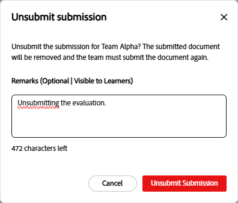

L&#39;envoi est supprimé et l&#39;état revient à **Envoi en attente**. L’équipe se déverrouille pour que vous puissiez modifier ses membres. Les membres de l’équipe reçoivent une notification et un e-mail. Tout membre peut alors soumettre à nouveau le document, et le nouveau fichier remplace le précédent. La nouvelle évaluation remplace l&#39;évaluation précédente et aucun historique n&#39;est conservé.

Une fois le cours terminé pour un membre de l’équipe, vous ne pouvez pas annuler l’envoi, car l’achèvement est irréversible.