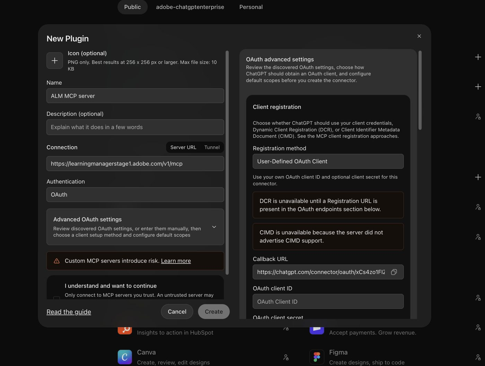
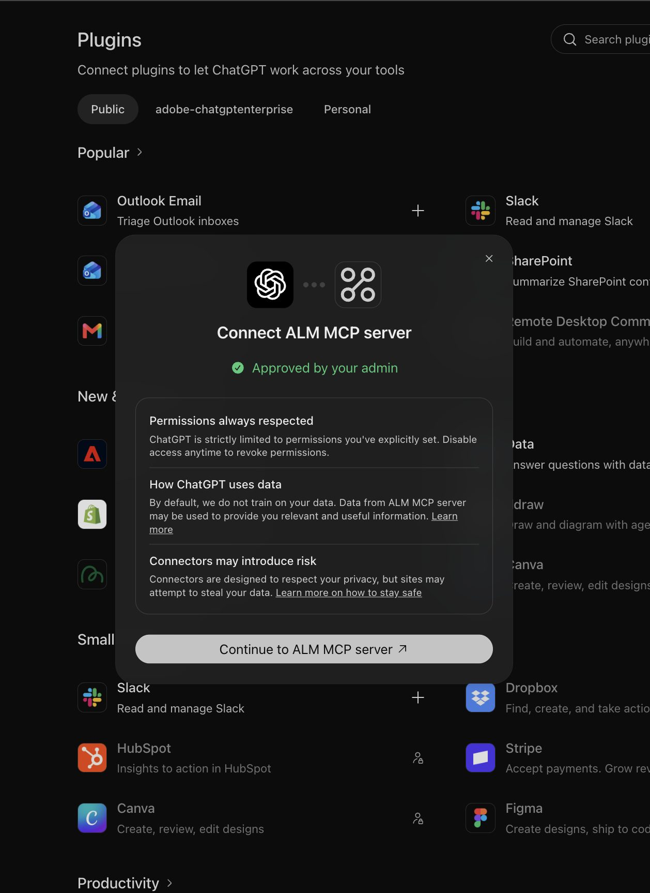

# Configuration du serveur MCP Adobe Learning Manager

## Présentation

La configuration comporte deux étapes. Tout d’abord, créez un serveur MCP dans Adobe Learning Manager. Ensuite, connectez le serveur à votre assistant IA. Ensuite, les élèves s’authentifient auprès de Adobe Learning Manager à partir de l’assistant AI, puis ils peuvent utiliser les outils MCP.

## Conditions requises

* Le serveur MCP est activé pour votre compte Learning Manager. Contactez votre chargé de réussite client ou le service clientèle Adobe pour l’activer. D’ici là, chaque demande renvoie 403 Interdit.
* Le serveur MCP est une fonctionnalité d&#39;indicateur d&#39;arrière-plan disponible uniquement pour les comptes **Ultimate**.
* L’administrateur de votre assistant IA est autorisé à ajouter et à configurer des connecteurs sur cette plateforme.

## Fonctionnement du logiciel

Un client MCP, tel que Claude ou ChatGPT, envoie des demandes à l’URL du serveur MCP avec le jeton d’accès OAuth de l’élève. Chaque outil s’exécute avec les autorisations de l’élève que le jeton représente. Par conséquent, un élève ne peut faire via le serveur MCP que ce qu’il est déjà autorisé à faire dans Adobe Learning Manager.

Le serveur utilise le flux de code d’autorisation OAuth 2.0. L’assistant IA s’authentifie en tant que client confidentiel avec l’ID client et le secret client d’une application Adobe Learning Manager. Le serveur ne prend pas en charge l&#39;inscription client dynamique OAuth.

## Création d’un serveur MCP dans Learning Manager

La création d’un serveur MCP configure une application OAuth et vous fournit l’URL du serveur MCP, l’ID du client et la clé secrète du client.

1. Connectez-vous à Learning Manager en tant qu’administrateur d’intégration.
2. Dans le menu de navigation, sélectionnez **Serveurs MCP**.
3. Dans le coin supérieur droit, sélectionnez **Créer**.

   

4. Sur la page **Détails de l&#39;application**, saisissez ce qui suit, puis sélectionnez **Suivant** :

   * **Nom de l&#39;application :** Saisissez jusqu&#39;à 50 caractères, par exemple ALM pour Claude. Les élèves voient ce nom lorsqu’ils autorisent la connexion. Choisissez donc un nom qu’ils reconnaissent.
   * **Rediriger les domaines :** entrez le domaine de rappel de chaque assistant IA, un domaine par ligne. Commencez chaque élément par et n’incluez pas de tracé. Ce champ est obligatoire.
   * **Description :** entrez jusqu&#39;à 150 caractères, par exemple, pour permettre aux élèves d&#39;utiliser ALM de Claude.

5. Sur la page **Configuration des outils**, passez en revue les outils et les descriptions utilisés par les assistants IA pour décider quand appeler chaque outil. Pour modifier une description, sélectionnez **Actions** (**...**) > **Modifier**. Pour restaurer la valeur par défaut, sélectionnez **Réinitialiser**. Sélectionnez ensuite **Suivant**.
6. Sur la page **Informations d&#39;identification du client**, copiez l&#39;**URL du serveur MCP**, l&#39;**ID client** et la **clé secrète client**. Conservez-les en lieu sûr. Vous en avez besoin pour connecter votre assistant AI.

Le serveur MCP a toujours une portée Élève, il n’y a donc aucune portée à sélectionner.

Enregistrez le domaine de chaque assistant IA que vous envisagez de connecter.

| **Assistant IA** | **Rediriger le domaine vers l&#39;enregistrement** | **URL de rappel complète (référence)** |
|----|----|----|
| Claude | [https://claude.ai](https://claude.ai/) et [https://claude.com](https://claude.com/) | <https://claude.ai/api/mcp/auth_callback> |
| ChatGPT | [https://chatgpt.com](https://chatgpt.com/) | <https://chatgpt.com/connector/oauth/&lt;id>\> (ChatGPT affiche l’ID pendant la configuration) |

>[!IMPORTANT]
>
>Enregistrez des domaines exacts, tels que [https://chatgpt.com](https://chatgpt.com/). N&#39;utilisez pas de caractères génériques partiels tels que [https://*chatgpt.com*](https://chatgpt.com)*, car ils peuvent correspondre à des domaines non liés. Pour autoriser les sous-domaines, utilisez un caractère générique de libellé entier tel que* [*https://*.example.com](https://encoded-592c9deb-987b-4562-aa3c-9fa3d37d83e9.uri/https%3a%2f%2f.example.com).

Un serveur MCP peut desservir plusieurs assistants IA si vous listez tous leurs domaines de redirection. Pour révoquer l’accès d’un assistant sans affecter les autres, créez un serveur MCP distinct pour chacun d’eux. Tous les serveurs utilisent la même URL de serveur MCP.

Il vous suffit d’indiquer l’URL du serveur MCP. Claude et ChatGPT découvrent automatiquement les points d’entrée OAuth de Learning Manager. Pour une configuration manuelle, affichez [les points de terminaison OAuth pour le serveur MCP Learning Manager](#oauth-endpoints-reference).

## Connecter votre client MCP

L’administrateur de votre assistant AI connecte le serveur MCP. Les interfaces client changent fréquemment. Si ces étapes ne correspondent plus, consultez la documentation du client.

>[!NOTE]
>
>Le client AI recadre et formate les réponses renvoyées par l’outil answer_learning_content_question, de sorte que la verbosité des réponses puisse varier d’un client à l’autre.

Avant de commencer, vérifiez que le serveur MCP est activé pour votre compte et que vous disposez de l’URL du serveur MCP, de l’ID client et du secret client de la section précédente.

### Connecter Claude Pro ou Max

**Remarque :** la verbalité des réponses aux questions posées change lorsque les réponses de l&#39;outil answer_learning_content_question sont recadrées et formatées par les clients.

1. Dans Claude, accédez à **Personnaliser** \> **Connecteurs**.
2. Sélectionnez **Ajouter** (+), puis sélectionnez **Ajouter un connecteur personnalisé**.
3. Saisissez les détails de connecteur, puis sélectionnez **Continuer** :

   1. **Nom :** Saisissez un nom reconnu par vos élèves, par exemple, Adobe Learning Manager.
   2. **URL du serveur MCP distant :** entrez l&#39;URL du serveur MCP à partir de la page Informations d&#39;identification du client, au format [https://\[alm-host\]/v1/mcp](https://[alm-host]/v1/mcp).

4. Sous **Authentification**, conservez **Connexion**. Claude lit les paramètres OAuth de Learning Manager et marque les options correspondantes comme *Détecté*.
5. Sous **Client OAuth**, sélectionnez **Utiliser votre propre client OAuth**. Collez l&#39;**ID client** et la **clé secrète client**.
6. Sélectionnez **Ajouter**. Claude ouvre la page de connexion à Learning Manager. Une fois connecté, le connecteur s’affiche comme connecté.

>[!NOTE]
>
>Claude attribue au champ Secret client un libellé facultatif, mais Learning Manager l’exige. Si vous laissez le champ vide ou si vous saisissez une valeur incorrecte, la connexion échoue et le message « Échec de l’autorisation » s’affiche.

### Connecter Claude Équipe ou Entreprise

Seul le propriétaire de l’organisation, ou un membre avec un rôle qui peut gérer les connecteurs, peut ajouter le connecteur. Les membres ne voient jamais l’ID ou le secret du client.

>[!NOTE]
>
>Le niveau de détail des réponses aux questions posées change lorsque les réponses de l’outil answer_learning_content_question sont recadrées et formatées par les clients.

1. Dans Claude, connectez-vous en tant que propriétaire d’organisation ou membre autorisé à gérer les connecteurs.
2. Accédez à **Paramètres de l’organisation** \> **Connecteurs**.
3. Sélectionnez **Ajouter**, survolez **Personnalisé**, puis sélectionnez **Web**.
4. Saisissez le nom et l&#39;URL du serveur MCP, puis définissez **Authentification** et **Client OAuth** comme décrit aux étapes 4 et 5 de la procédure précédente.
5. Sélectionnez **Ajouter**.

Le connecteur est maintenant disponible pour votre organisation. Chaque membre sélectionne **Connect** et se connecte à Learning Manager avec son propre compte.

### Connecter ChatGPT Team ou Enterprise

>[!NOTE]
>
>Le niveau de détail des réponses aux questions posées change lorsque les réponses de l’outil answer_learning_content_question sont recadrées et formatées par les clients.

1. Connectez-vous à ChatGPT en tant que propriétaire ou administrateur de l’espace de travail.
2. Dans la barre latérale gauche, cliquez sur **Plug-ins**.
3. Cliquez sur **Ajouter** dans le coin supérieur droit et sélectionnez **Créer une application MCP**.
4. Dans la fenêtre **Nouveau plug-in**, configurez la connexion :

   * **Nom :** Adobe Learning Manager, ou le nom par lequel vos élèves connaissent votre plateforme d&#39;apprentissage.
   * **Connexion :** maintenez **URL du serveur** sélectionnée et entrez [https://\[alm-host\]/v1/mcp](https://[alm-host]/v1/mcp)
   * **Authentification :** OAuth

   

5. Cliquez sur **Paramètres OAuth avancés**. ChatGPT détecte automatiquement les points d’entrée OAuth ALM.
6. Sous **Inscription du client**, conservez **Méthode d&#39;inscription** définie sur **Client OAuth défini par l&#39;utilisateur**, puis entrez l&#39;**ID de client OAuth** et le **secret de client OAuth** à partir de l&#39;étape 1.
7. Vérifiez l&#39;**URL de rappel** affichée dans ce panneau. Son domaine (<https://chatgpt.com>) doit se trouver dans **Rediriger les domaines** du serveur MCP à partir de l&#39;étape 1.

   

       **Les points de terminaison sont découverts automatiquement**
   
   En règle générale, il n’est pas nécessaire de modifier les points d’entrée OAuth. Si ChatGPT les demande, utilisez : Auth URL [https://\[alm-host\]/oauth/o/authority](https://[alm-host]/oauth/o/allow), Token URL [https://\[alm-host\]/oauth/token](https://[alm-host]/oauth/token), Registration URL empty, Resource [https://\[alm-host\]/v1/mcp](https://[alm-host]/v1/mcp), scope learner:write.

8. Sélectionnez **Je comprends et je veux continuer**, puis cliquez sur **Créer**.
9. Dans la fenêtre **Connect**, cliquez sur **Continuer** et connectez-vous à ALM. La fenêtre doit afficher *Approuvé par votre administrateur*.
10. Mettez le plug-in à la disposition des utilisateurs cibles dans votre espace de travail.

    

## Authentification des utilisateurs finaux

Une fois que l’administrateur a terminé la configuration, les élèves ajoutent le connecteur Adobe Learning Manager à partir de la liste des connecteurs de leur assistant IA et sélectionnent Se connecter. La page de connexion à Adobe Learning Manager s’ouvre. Une fois que l’élève s’est connecté (via l’authentification unique, si le compte l’utilise) et a approuvé l’accès, l’assistant IA est lié au compte Adobe Learning Manager de l’élève.

>[!NOTE]
>
>Si le navigateur dispose déjà d’une session Adobe Learning Manager active, l’assistant se connecte à cet utilisateur sans demander d’informations d’identification. Pour vous connecter en tant qu’utilisateur différent, déconnectez-vous d’abord de Adobe Learning Manager ou utilisez une fenêtre de navigateur privée.

L’authentification est une étape unique. Si l’accès d’un élève est révoqué ou si sa session expire, l’assistant lui demande de se reconnecter.

## Faire pivoter le secret du client ou révoquer l’accès

Vous ne pouvez pas régénérer une clé secrète client. Pour le faire pivoter :

1. Créez un nouveau serveur MCP, comme décrit précédemment dans cet article.
2. Mettez à jour votre assistant IA avec le nouvel ID client et la nouvelle clé secrète client.
3. Dans **Administrateur d&#39;intégration** > **Serveurs MCP**, sélectionnez **Actions** (**...**) > **Supprimer** pour l&#39;ancien serveur.

Les élèves doivent se reconnecter une fois que vous avez changé de compte.

Pour déconnecter un assistant AI pour tous les élèves, supprimez son serveur MCP de la même page.

## Outils disponibles

Le serveur MCP expose les outils suivants. Tous s’exécutent avec les autorisations de l’élève connecté.

<table>
<colgroup>
<col style="width: 46%" />
<col style="width: 31%" />
<col style="width: 21%" />
</colgroup>
<thead>
<tr>
<th><strong>Outil</strong></th>
<th><strong>Ce qu’il fait</strong></th>
<th><strong>Exemples d’invites</strong></th>
</tr>
</thead>
<tbody>
<tr>
<td>search_learning_items</td>
<td>Recherche dans le catalogue des cours, des parcours d’apprentissage, des certifications, des assistances à la tâche, des badges, des compétences, des catalogues et des balises. Filtres : type, état de l’élève, compétence, balise, catalogue, format de livraison, prix et langue. Renvoie jusqu’à 10 résultats par page.</td>
<td>« Cours Python pour débutants » 
« Formations gratuites en salle de classe en français »</td>
</tr>
<tr>
<td>list_my_learning_enrollments</td>
<td>Répertorie l’apprentissage auquel l’élève est inscrit, en cours et terminé, avec l’état, la progression et l’échéance. Inscription la plus récente en premier par défaut.</td>
<td>« À quoi suis-je inscrit ? » 
« Qu'est-ce qui va bientôt arriver ? » 
« Mes formations terminées »</td>
</tr>
<tr>
<td>get_learning_object</td>
<td>Obtient des détails complets sur un cours, un parcours d'apprentissage, une certification ou une assistance à la tâche par ID, y compris éventuellement des instances, des compétences et des sous-éléments.</td>
<td>« Parlez-moi du deuxième cours »</td>
</tr>
<tr>
<td>get_my_learning_profile</td>
<td>Obtient le profil ALM de l’élève, y compris le compte et le responsable.</td>
<td>« Qui est mon responsable dans ALM ? »</td>
</tr>
<tr>
<td>answer_learning_content_question</td>
<td>Répond aux questions sur le sujet du cours à l’aide de l’assistant d’apprentissage ALM, en s’appuyant sur le contenu du cours avec des citations. Renvoie un ID de conversation que l'assistant utilise pour les questions de suivi.</td>
<td>« Expliquer TCP et UDP comme traité dans mon cours de mise en réseau »</td>
</tr>
<tr>
<td>custom_learning_path</td>
<td>Fournit des parcours d’apprentissage personnalisés dans Adobe Learning Manager, adaptés aux objectifs, aux sujets et aux besoins d’apprentissage d’un élève. Prend en charge la génération de recommandations de cours, l’enregistrement d’un parcours d’apprentissage sélectionné sur le compte de l’élève, la liste des parcours d’apprentissage enregistrés de l’élève (liste d’actions) et l’obtention des détails et des cours d’un parcours d’apprentissage enregistré par son id (détails d’actions). Aide les élèves à identifier le contenu d’apprentissage pertinent pour développer leurs compétences et atteindre leurs objectifs d’apprentissage.</td>
<td>« Enregistrer le parcours d’apprentissage sélectionné sur mon compte. »</td>
</tr>
</tbody>
</table>

Les conversations démarrées via answer_learning_content_question apparaissent dans le rapport de conversation sur l’IA dédiée aux élèves, de la même manière que les conversations dans l’assistant d’apprentissage ALM.

## Limites

| **Limite** | **Valeur** |
|----|----|
| Résultats par page (recherche et inscriptions) | Jusqu’à 10. Utilisez le curseur renvoyé pour afficher plus de pages. |
| taux de questions answer_learning_content_question | 10 demandes par minute par élève (rafale de 5), avec au plus 2 demandes en cours à la fois |
| Versions du protocole MCP prises en charge | 2025-11-25, 2025-06-18, 2025-03-26 |
| Transport | HTTP pouvant être diffusé en continu, sans état (POST uniquement ; aucun flux d&#39;événements envoyé par le serveur) |

## Référence des points de terminaison OAuth {#oauth-endpoints-reference}

Claude et ChatGPT les découvrent automatiquement. Ils sont répertoriés ici pour les clients ou les proxys qui ont besoin d’être saisis manuellement. Remplacez `alm-host` par l&#39;hôte dans l&#39;URL de votre serveur MCP (votre hôte de région ou domaine personnalisé ALM).

| **Valeur** | **URL** |
|----|----|
| URL du serveur MCP | [https://\[alm-host\]/v1/mcp](https://[alm-host]/v1/mcp) |
| URL d’autorisation | [https://\[alm-host\]/oauth/o/allow](https://[alm-host]/oauth/o/allow) |
| URL du jeton | [https://\[alm-host\]/oauth/token](https://[alm-host]/oauth/token) |
| Actualiser l’URL | [https://\[alm-host\]/oauth/token/refresh](https://[alm-host]/oauth/token/refresh) |
| Base du serveur d’autorisations | [https://\[alm-host\]](https://[alm-host]) |
| Ressource | [https://\[alm-host\]/v1/mcp](https://[alm-host]/v1/mcp) |
| Portée | élève:write |

## Dépannage

| **Symptôme** | **Cause et correction** |
|----|----|
| Redirection non enregistrée lors de la connexion | Le domaine de rappel de l&#39;assistant AI ne se trouve pas dans les **domaines de redirection** de l&#39;application. Ajoutez-le (par exemple, <https://claude.ai>) et réessayez. |
| La connexion réussit, puis l’assistant indique que l’autorisation a échoué (client non valide) | La clé secrète client entrée dans l&#39;assistant ne correspond pas à l&#39;application. Copiez-le à nouveau à partir d’ALM, vérifiez les espaces supplémentaires et reconnectez-vous. |
| Toutes les demandes retournent 403 Interdit | Le serveur MCP n’est pas activé pour votre compte. Contactez l’assistance Adobe. |
| Connecté avec le mauvais utilisateur ALM | Le navigateur disposait déjà d&#39;une session ALM. Déconnectez-vous, déconnectez-vous d’ALM (ou utilisez une fenêtre privée), puis reconnectez-vous. |
| « Limite de taux dépassée » à partir de l’outil Q&amp;R | L’élève a dépassé la limite de taux de questions-réponses. Patientez une minute et réessayez. |
| L’assistant demande à se reconnecter | Le jeton de l’élève a expiré ou a été révoqué. Cliquez à nouveau sur **Se connecter**. |

## FAQ

**Les élèves peuvent-ils utiliser le serveur MCP sans qu’un administrateur ne le configure ?**
Non. Un administrateur d’intégration doit créer un serveur MCP dans Adobe Learning Manager (étape 1), car le serveur MCP ne prend pas en charge l’enregistrement dynamique des clients.

**Pouvons-nous utiliser notre propre domaine ?**
Oui. Si votre compte Adobe Learning Manager possède un domaine personnalisé, utilisez-le à la place de `alm-host` dans toutes les URL.

**Quels rôles ALM peuvent utiliser le serveur MCP ?**
Tout utilisateur Adobe Learning Manager peut se connecter. Les outils agissent dans le contexte de l’élève et les propres vérifications d’autorisation d’ALM s’appliquent à chaque demande.
