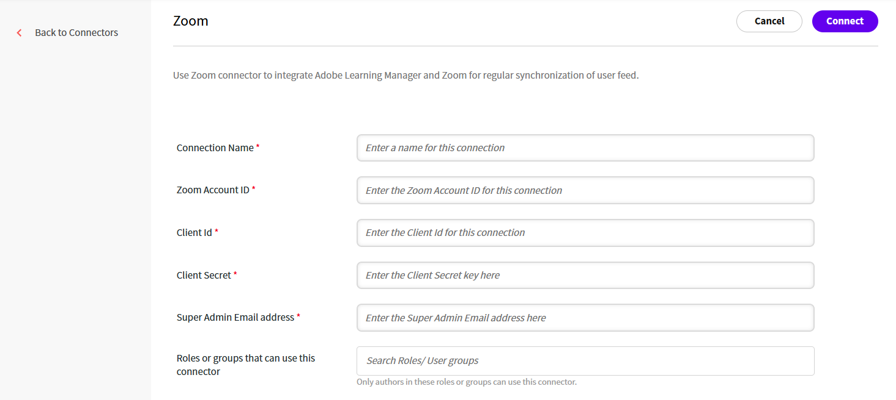

# Connecteur de zoom dans Adobe Learning Manager

## Introduction

Le Connecteur Zoom de Adobe Learning Manager permet aux organisations d’organiser des sessions de classe virtuelle en direct, de gérer les inscriptions des élèves et de suivre l’assiduité et l’achèvement. Il prend également en charge plusieurs connexions Zoom au sein d’un même compte, ce qui permet aux administrateurs d’intégration de gérer l’accès en fonction des rôles ou des groupes d’utilisateurs et des auteurs pour sélectionner les connexions disponibles pour les sessions de cours. Après la session, les données de présence et de performances sont synchronisées avec Adobe Learning Manager pour la création de rapports et le suivi.

## Configuration du connecteur Zoom

Pour configurer le Connecteur de zoom :

1. Connectez-vous à Adobe Learning Manager en tant qu’administrateur d’intégration.
2. Survolez la vignette **Zoom**.

   
   _Configuration du Connecteur de zoom dans Adobe Learning Manager_

3. Sélectionnez **Se connecter**. La page de configuration du connecteur Zoom s’ouvre.
4. Saisissez les détails de compte suivants dans les champs respectifs. Vous pouvez obtenir ces informations d’identification auprès de votre administrateur de compte Zoom :

   * Nom de la connexion
   * ID de compte Zoom
   * ID du client
   * Secret du client
   * Adresse e-mail du super administrateur
   * Rôles ou groupes pouvant utiliser ce connecteur (facultatif)

   
   _Tapez les détails de configuration pour configurer le connecteur de zoom_

5. Sélectionnez **Se connecter** pour établir l&#39;intégration.

>[!NOTE]
>
>Lors de l&#39;activation du connecteur, les **élèves doivent utiliser la même adresse e-mail** pour leurs comptes Zoom et Adobe Learning Manager afin de s&#39;assurer que les données utilisateur sont correctement synchronisées.

## Ajout de plusieurs connexions Zoom

Vous pouvez ajouter plusieurs connexions Zoom à Adobe Learning Manager, chaque connexion étant liée à un compte Zoom différent. Par exemple, vous pouvez créer des connexions distinctes pour différents partenaires ou équipes et spécifier quels rôles ou groupes d’utilisateurs peuvent utiliser chaque connexion.

Le nombre de connexions que vous pouvez ajouter dépend du niveau de votre compte Adobe Learning Manager :

| **Niveau de compte** | **Nombre maximum de connexions Zoom** |
|---|---|
| l’application | 6 |
| Ultimate | 50 |

## Création de cours Zoom

Une fois la connexion établie :

1. Connectez-vous en tant qu&#39;**auteur** et créez un nouveau cours de classe virtuelle.
2. Sélectionnez **Zoom** comme système de conférence, puis sélectionnez la connexion Zoom que vous souhaitez utiliser dans la liste.
   >[!NOTE]
   >
   >La liste affiche uniquement les connexions disponibles pour votre rôle ou votre groupe d’utilisateurs, et une session utilise une connexion à la fois.
3. Affectez des élèves au cours via des administrateurs, des responsables ou par le biais d’une auto-inscription.
4. Lors de l’inscription, les élèves reçoivent un e-mail avec les détails du cours.
5. Les élèves peuvent se connecter à leur compte Adobe Learning Manager pour accéder au cours et rejoindre la session Zoom.

## Connexions Zoom disponibles pour les auteurs

Lorsque vous créez ou modifiez une session de cours, vous pouvez choisir parmi les connexions Zoom disponibles pour votre rôle ou groupe d&#39;utilisateurs. L’administrateur d’intégration définit les rôles ou groupes d’utilisateurs pouvant accéder à chaque connexion Zoom.

Par exemple, supposons qu’un administrateur d’intégration configure deux connexions Zoom, **Partner A Zoom** et **Partner B Zoom**, et attribue chaque connexion à un groupe d’utilisateurs différent :

* Si vous appartenez à la fois au groupe Partenaire A et au groupe Partenaire B, vous pouvez sélectionner l&#39;une ou l&#39;autre connexion.
* Si vous appartenez uniquement au groupe Partenaire A, vous pouvez sélectionner **Zoom Partenaire A**.
* Si vous n’appartenez à aucun de ces groupes, ces connexions ne peuvent pas être sélectionnées.

>[!NOTE]
>
>Vous ne pouvez utiliser qu’une seule connexion Zoom par session. Si plusieurs connexions sont disponibles, sélectionnez la connexion que vous souhaitez utiliser pour la session.

## Gestion des connexions Zoom

La page **Gérer les connexions** affiche les connexions Zoom configurées pour votre compte. La colonne **Visible par** indique les rôles ou groupes d&#39;utilisateurs qui peuvent utiliser chaque connexion. À partir de cette page, vous pouvez modifier, activer ou désactiver, ou encore supprimer des connexions Zoom existantes.

### Modification d’une connexion Zoom

Pour modifier une connexion Zoom existante :

1. Sélectionnez la connexion sur la page **Gérer les connexions** que vous souhaitez modifier.
1. Dans l’onglet Configurer, mettez à jour l’un des éléments suivants :

   1. Pour mettre à jour les informations d&#39;identification du compte Zoom, sélectionnez **Modifier** en regard de **Informations d&#39;identification** et mettez à jour les détails requis.
   1. Pour modifier qui peut utiliser la connexion, mettez à jour les **rôles ou groupes** qui peuvent utiliser ce connecteur.

1. Sélectionnez **Enregistrer**.

### Activation ou désactivation d’une connexion Zoom

Les nouvelles connexions Zoom sont activées par défaut. Vous pouvez désactiver une connexion pour empêcher les auteurs de l’utiliser sans supprimer la connexion.

Pour désactiver une connexion :

1. Sur la page **Gérer les connexions**, sélectionnez la connexion que vous souhaitez désactiver.
1. Activez la **Activer la connexion**.
1. Sélectionnez **Enregistrer**.

   La connexion désactivée n’est plus disponible pour les utilisateurs des rôles ou groupes associés.

Pour réactiver la connexion, sélectionnez **Activer la connexion**, puis **Enregistrer**.

### Suppression d’une connexion Zoom

Pour supprimer une connexion Zoom :

1. Sur la page **Gérer les connexions**, accédez à la connexion que vous souhaitez supprimer.
1. Sélectionnez l&#39;icône **Supprimer** en regard de la connexion.
1. Sélectionnez **Supprimer**.

## Suivi de l’assiduité et de l’achèvement

Après la fin de la session virtuelle :

* Adobe Learning Manager reçoit automatiquement l’état d’achèvement de Zoom.
* Les administrateurs peuvent afficher les rapports de présence et de score dans Adobe Learning Manager pour suivre la participation et les performances des élèves.

## Création d’une application OAuth Zoom de serveur à serveur

Pour utiliser le Connecteur Zoom avec Adobe Learning Manager, vous devez créer une application OAuth Zoom de serveur à serveur et configurer les portées requises.

### Portées OAuth requises

Lors de la création de l’application dans Zoom, assurez-vous que les portées suivantes sont sélectionnées :

| Ce que vous voulez | Rechercher ce mot-clé | Puis choisir |
|---|---|---|
| Afficher toutes les réunions d’utilisateurs | réunion | `meeting:read:meeting:admin, meeting:read:list_meetings:admin` |
| Afficher/gérer toutes les réunions d’utilisateurs | réunion | `meeting:update:meeting:admin, meeting:delete:meeting:admin, meeting:write:meeting:admin` |
| Afficher les données du rapport | rapport | `report:read:meeting:admin, report:read:user:admin` (Choisissez celui qui correspond à votre point de terminaison.) |
| Afficher toutes les informations utilisateur | l&#39;interface | `user:read:user:admin, user:read:list_users:admin` |
| Gérer les utilisateurs et les utilisatrices | l&#39;interface | `user:update:user:admin, user:write:user:admin` |
| Ajout d’un participant à une réunion | inscrit | `meeting:write:registrant:admin` |
| Répertorier tous les participants à la réunion | inscrit | `meeting:read:list_registrants:admin` |
| Réunions de sous-comptes | réunion + rechercher :master | `meeting:write:meeting:master` |
| Rapport sur les participants à la réunion | participant | `report:read:list_meeting_participants:admin` |

